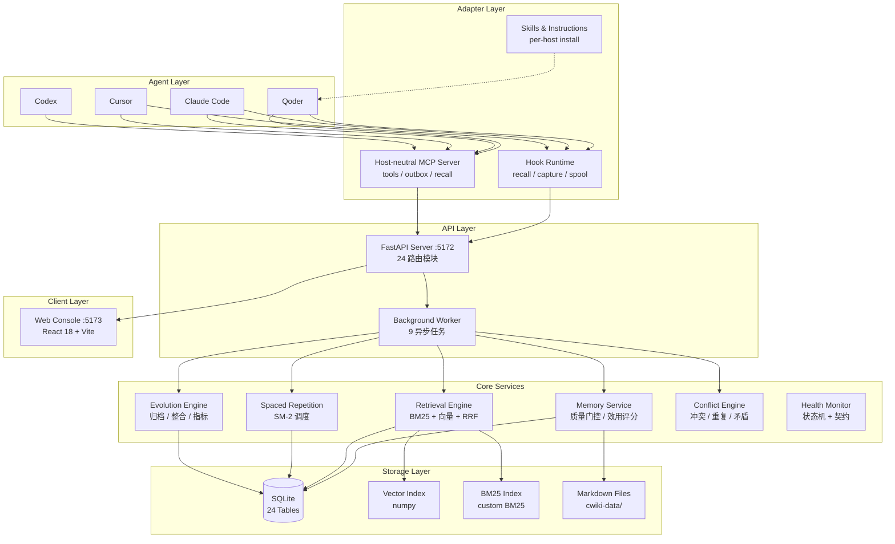
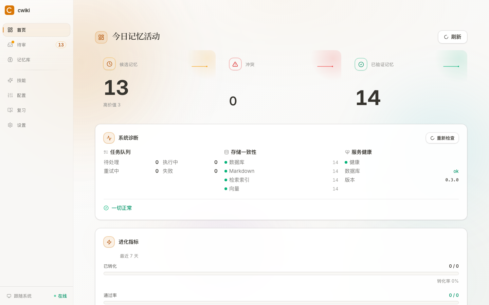
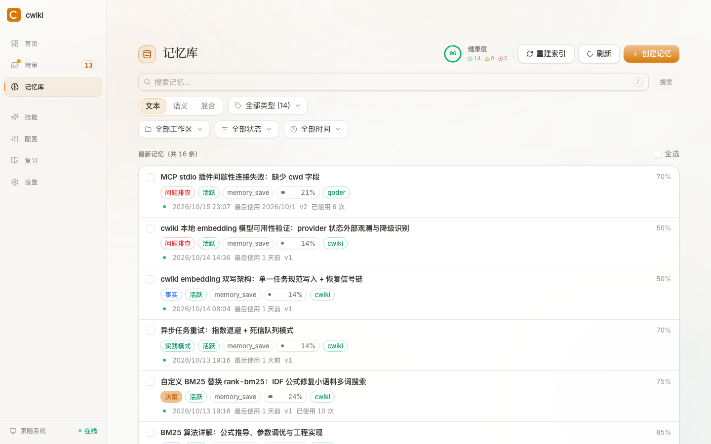

# cwiki

<div align="center">

**Agent Persistent Memory & Knowledge Infrastructure**

*让 AI Agent 拥有持续学习的长期记忆*

[](https://www.python.org/)
[](https://fastapi.tiangolo.com/)
[]()

</div>

---

cwiki 为 AI Agent 提供知识的持久化存储、智能检索和持续进化能力。Agent 的工作过程自动转化为可检索、可复用、可演进的长期记忆，使 Agent 在跨会话、跨项目场景下具备持续学习能力。

## 核心能力

### 记忆管理

| 能力 | 说明 |
|------|------|
| 自动记忆捕获 | 通过 MCP / HTTP API 接收 Agent 提交的工作事件与知识信号 |
| 两阶段提交 | 会话笔记快速捕获，手动形式化为正式记忆 |
| 类型系统 | 11 种记忆分类，自动类型推断，类型仅分类不做格式约束 |
| 间隔重复 | SM-2 算法调度复习，追踪掌握度（new → learning → familiar → proficient → mastered） |
| 自动演化 | 高相似记忆自动整合（BM25 + Jaccard 预筛，auto-merge 后源记忆归档） |
| 反馈闭环 | Agent 和人类可对记忆进行有用 / 无用 / 过时反馈，驱动记忆演进 |

### 检索与智能

| 能力 | 说明 |
|------|------|
| 混合检索 | BM25（增量更新）+ 向量检索（numpy）→ RRF 融合 → 多信号 Rerank → 多样性过滤 |
| 质量评估 | 5 维质量门控 + 6 维价值评分 + 5 因子效用评分 + 健康状态机 |
| 冲突检测 | 新候选与已有记忆的自动冲突 / 重复 / 合并检测 |
| 主动推送 | 基于对话关键词主动推送相关记忆，无需手动检索 |
| 记忆关联 | 关系图谱（相关、取代、依赖等），支持多层深度查询 |

### 安全与体验

| 能力 | 说明 |
|------|------|
| 可靠投递 | Outbox 机制确保写入不丢失，失败自动重试，耗尽后保留待人工处理 |
| 运维诊断 | 队列状态快照 + FAILED 死信重放、DB/MD/索引四方一致性对账端点 |
| 内容安全 | MCP 提交时自动检测 Prompt 注入等恶意内容 |
| Web 控制台 | 记忆浏览、搜索、审核、状态监控，响应式布局 + 亮暗主题 |
| 通用适配 | 通过 MCP 协议接入任意 Agent（Qoder 已内置 17 个工具） |

---

## 系统架构



> 详细架构、项目结构、技术栈、数据库 Schema → [docs/architecture.md](docs/architecture.md)

---

## 快速开始

```bash
# 一站式安装（环境预检 → .venv → Python/前端依赖 → 数据库 → Agent 接入）
python tasks.py install

# 一键启动后端 + 前端
python tasks.py start
```

**分别启动：**

```bash
# 终端 1 — 后端 API（:5172）
python tasks.py serve

# 终端 2 — 前端界面（:5173）
python tasks.py web
```

> 日常浏览建议用生产模式（内存占用约为 dev 模式一半）：`python tasks.py preview`（构建并以 :4173 启动）。`web` 的 dev 服务器留给开发调试。

> 环境要求：Python >= 3.11，Node.js >= 18。`install` 会自动检测并提示缺失项；未装 Node.js 时传 `--skip-web` 跳过前端。

## 30 秒体验路径

1. `python tasks.py install` — 一站式安装（自动预检环境、创建 .venv、装依赖、初始化 DB）
2. `python tasks.py start` — 一键启动后端（:5172）与控制台（:5173）
3. 打开 [http://localhost:5173](http://localhost:5173) 进入控制台
4. 在「记忆库」页新建一条记忆；Agent 经 MCP 提交的候选会出现在「待审」页，等待人工审核
5. 在搜索框输入关键词，查看混合检索结果





---

## 典型使用场景

### Agent 跨会话记忆

Agent 的工作过程经 MCP 工具提交为候选记忆，人工审核后沉淀为可信知识；下次会话开始时自动提醒检索、面向任务主动推送相关记忆，避免重复踩坑。写入端带本地暂存与失败重试，后端重启不丢数据。

### 个人知识沉淀与间隔复习

记忆按 11 种类型组织，SM-2 算法调度间隔复习并追踪掌握度（new → mastered）；高相似记忆自动整合归档，让知识库越用越准而不是越堆越多。

### 多设备 Git 同步

数据整体存放在独立数据仓库（Markdown + `_meta` + SQLite），一条 `python cwiki-data/sync.py` 完成推拉同步；换设备时即使删除 SQLite，也能从 Markdown + `_meta` 完整重建，索引无需重新 embedding。

---

## 实测效果

> 数据来自 W3 基线回归报告（[w3-regression-report.md](benchmarks/reports/w3-regression-report.md)，2026-10-15）与 `benchmarks/reports/` 下评测 JSON，仓库内可复现。

**评测集**：`eval-fixture` 夹具——99 条记忆、101 查询、983 条相关性判定（`benchmarks/fixtures/fixture_meta.json`）。

**检索管线**（101 查询，vs W1 基线逐指标回归通过）：

| Pipeline | Recall@10 | MRR | nDCG@10 | Useful@10 |
|----------|-----------|-----|---------|-----------|
| full_pipeline | 0.8478 | 0.7381 | 0.6458 | 0.1842 |
| hybrid_rrf_rerank | 0.8547 | 0.7406 | 0.6478 | 0.1851 |

**上下文组装**（26 查询，W3 修复后四项全达标）：

| 指标 | 数值 |
|------|------|
| Selection Recall（应选尽选） | 1.0000 |
| Negative Exclusion Rate（负例拦截） | 1.0000 |
| Budget Compliance（预算遵守） | 1.0000 |
| Conflict Warning Recall（冲突告警） | 1.0000 |

**性能**（10K 记忆规模 × 100 查询，`benchmarks/reports/performance/performance-report.json`）：

| 指标 | p50 | p95 |
|------|-----|-----|
| 检索全管线 | 1.10ms | 3.92ms |
| 上下文组装 | 0.33ms | 0.33ms |

**复现命令**：

```bash
# 检索评测（--pipeline 可选 full_pipeline / hybrid_rrf_rerank / hybrid_rrf / baseline_bm25 / baseline_vector）
python -m benchmarks.runners.retrieval_runner

# 与基线回归对比
python -m benchmarks.runners.compare_reports --current benchmarks/reports/eval-fixture
```

全量测试 1766 项通过（W3 报告验收记录）。

---

## Agent 接入

> 第一次接入？按 [Agent 接入指南](docs/agent-onboarding.md) 走：最小 MCP 配置（含关键 `cwd` 字段）、HTTP API 直连示例、兼容性验证清单与规则式故障排查。

### Qoder Plugin（推荐）

```bash
# 注册 MCP + 启用 hooks + 更新 AGENTS.md + 安装 skill + 初始化数据库
python scripts/setup.py
```

setup 仅更新 `<!-- cwiki:begin -->` / `<!-- cwiki:end -->` 管理的区块，保留其他用户内容。详见[安装与更新说明](docs/development.md#agent-接入配置)。

接入后获得：

- **17 个 MCP 工具** — `memory_search`、`memory_save`、`memory_tags`、`memory_history`、`memory_review_due`、`memory_review_submit`、`memory_review_stats` 等
- **cwiki-save skill** — 按需提取与保存记忆
- **3 个斜杠命令** — `/memory-status`、`/memory-search`、`/memory-review`

> MCP 负责工具契约与可靠写入，AGENTS 定义行为契约，skill 独占提取质量与检查点策略。
> 完整工具清单 → [MCP 工具参考](adapters/qoder/README.md#mcp-tools)，写入契约 → [记忆系统](docs/memory-system.md#写入契约)

### HTTP API

```bash
curl -X POST http://127.0.0.1:5172/v1/events \
  -H "Content-Type: application/json" \
  -d '{"events": [{"agent": "...", "session": "...", "workspace": "...", "event_type": "prompt.submitted", "sequence": 0, "timestamp": "2026-01-01T00:00:00Z", "payload": {}}]}'
```

---

## 数据存储

三层存储策略，各司其职：

| 层 | 技术 | 文件 | 说明 |
|----|------|------|------|
| 主存储 | SQLite | `cwiki-data/cwiki.db` | 25 张 ORM 表，事务一致性 |
| 文件存储 | Markdown | `./cwiki-data/{workspace}/{type}/` | 人类可读可编辑，YAML frontmatter |
| 关系数据 | JSON | `cwiki-data/_meta/{memory_id}.json` | feedback / usage / review_schedule 等，随 Markdown 一同 Git 同步 |
| 索引层 | SQLite + numpy | `cwiki-data/index.db` + `cwiki-data/vectors.npz` | BM25 全文索引 + 向量索引，可随时重建 |

记忆文件格式：`{id前8位}_{标题}.md`，含完整 YAML frontmatter 和 Markdown 正文。

---

## Git 同步

`cwiki-data/`（Markdown + `_meta/` 关系数据 JSON + `cwiki.db` + `index.db` + `vectors.npz`）以**独立数据仓库**（目录内自带 `.git`）随 GitHub 私有仓库在多台设备间同步，代码与数据提交历史分离；SQLite 与索引文件均为可重建产物，可随时从 MD + `_meta/` 完整恢复。

```bash
# 首次迁移：SQLite 导出为 MD + _meta（仅需执行一次）
python tasks.py migrate-to-git

# 日常同步（数据仓库自管，随 cwiki-data.git 分发）：WAL checkpoint → 导出 MD + _meta → 在数据仓库 commit → pull 远端 → push
python cwiki-data/sync.py

# 启动服务：自动 pull 代码仓库 + DB 缺失时自动重建
python tasks.py start

# 手动重建数据库 / 重算派生字段（rebuild-db 完成后自动 recompute）
python tasks.py rebuild-db
python tasks.py recompute
```

冲突处理兜底：Markdown 走 git 原生合并；`cwiki.db` 为二进制不可合并，冲突时可任选一端，或删除本地 DB 与索引后经 `rebuild-db` 从 MD + `_meta/` 重建（可再用 `python scripts/verify_rebuild.py` 校验三方一致）。旧单仓库设备的一次性迁移见 [Git 同步指南](docs/git-sync.md)「从单仓库迁移」。

---

## 文档索引

| 文档 | 内容 |
|------|------|
| [架构设计](docs/architecture.md) | 系统架构、项目结构、技术栈、数据库 Schema |
| [记忆系统](docs/memory-system.md) | 生命周期、候选流水线、演化、健康状态机、评分体系 |
| [检索引擎](docs/retrieval.md) | 检索流程、Rerank 信号权重、各阶段详解 |
| [Agent 接入指南](docs/agent-onboarding.md) | MCP 最小配置、HTTP API 直连、兼容性验证清单、故障排查 |
| [Git 同步](docs/git-sync.md) | 多设备同步、冲突处理、数据库重建与故障排查 |
| [API 参考](docs/api-reference.md) | 23 个路由模块、核心接口、反馈与冲突 |
| [开发指南](docs/development.md) | 安装配置、开发命令、config.yaml 完整参考 |
| [学习文档](docs/dev-learning-guide.md) | 架构与实现原理逐层讲解 |

---

<div align="center">

**Made with ❤️ for AI Agents**

</div>
