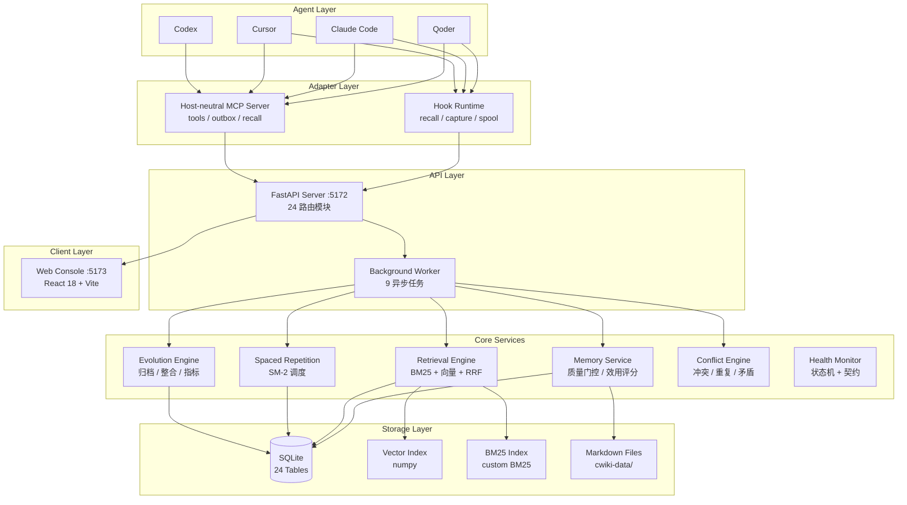

# 架构设计

## 系统架构



---

## 记忆写入与 Agent 职责

| 层 | 职责 |
|----|------|
| MCP | 定义工具参数与响应契约、安全检查、类型分类；通过 write-ahead outbox 与幂等写入保障投递可靠性 |
| AGENTS | 行为契约（触发条件 + 关键约定），约 10 行；不另设提取策略或重复工具用法 |
| [cwiki-save skill](../skills/cwiki-save/SKILL.md) | 唯一维护知识提取策略：双重价值判断（agent 记忆 + 个人学习平台）、分类信号识别、查重决策流程、内容组织与排版模式、标题生成与类型辨析、检查点与反馈校准 |

### 读路径与降级

- `memory_search`（含 `curated`）与 hook 的 `UserPromptSubmit` 召回优先读取 `cwiki-data/cwiki.db`（`mode=ro`），在进程内构建 BM25 索引，不依赖 API。
- **本地优先**：本地结果覆盖率 ≥ `STRONG_COVERAGE (0.6)` 视为强命中，直接返回；弱命中/空结果才请求 API 走完整混合检索（语义 + RRF + 重排）。`mode=semantic` 是显式语义请求，保持 API 优先。
- API 连接失败或 5xx 时回落本地关键词检索，响应带 `degraded: true` 与 `warnings`；4xx 属于请求错误，原样返回，不触发降级。
- 本地检索使用二元组分词（不加载 jieba，避免 hook 超时）与 IDF 覆盖率门控（`MIN_COVERAGE 0.5`）抑制误召回；写入仍必须经 API + outbox。

### 写入与注入策略

- `agent_policy.write_decisions`：SessionStart 注入结构化写入决策（write/skip/update，优先级 skip > update > write），`memory_save` 时服务端复核；`update` 命中相似记忆时提示改用 `memory_update`。写入后的审核仍由 `memory.write_policy` 管理。
- `memory.write_policy`：候选创建后按 `auto / review / reject` 规则决策，命中信息随候选持久化；`auto` 在评分任务中优先自动生效，`reject` 直接拒绝提交。
- `agent_policy.always_inject`：SessionStart 从本地 SQLite 注入永久记忆与指定类型/标签（默认 feedback/rule/pinned），受 `max_items` 与 `max_chars` 预算约束，不依赖 API。
- `memory_update(is_permanent=true, permanent_reason=...)` 是“必须常驻”的显式入口；永久记忆参与健康分保底与常驻注入。

### 写入规则

- `memory_save` 要求 Agent 概括主题生成并显式传入 `title`，标题最大长度默认 80 个字符（`config.yaml` 的 `memory.title_max_length`）；MCP 不自动生成标题或添加临时前缀。
- `type` 可选，自动推断或指定类型时都按语义原样保存正文（仅做空白规范化）；类型只用于分类，不规定段落、替身映射或篇幅。
- 服务端校验标题长度、有效类型及 `len(content.strip()) >= 20`；`strip()` 仅用于校验，不改写原文。
- `memory_update` / HTTP `PATCH /v1/memories/{id}` 未提供的字段保持不变；`content` 整体替换正文而非追加或局部补丁，需传完整新版正文。

### 审核与安全

候选创建后以 `pending_review` 进入 Embedding → 价值评分；满足 `auto_approve` 阈值时自动转正，否则进入人工审核。`memory.write_policy` 命中规则时可覆盖该行为（auto / review / reject），规则 id 随候选留痕。安全检查保持启用，没有自动格式化任务。检查点只对有限的已采集事件和笔记做规则提取，不代表完整对话检查。

> 详细契约见[记忆系统](memory-system.md)。安装更新及宿主/API 分别重载见[开发指南](development.md#agent-接入配置)。

---

## 项目结构

```
cwiki/
├── apps/
│   ├── api/                  # FastAPI 服务端（24 个路由模块）
│   │   ├── main.py           # 应用入口（含进程内任务队列）
│   │   ├── auth.py           # 本地单用户模式，默认身份，无 token 认证
│   │   └── routes/           # workspaces / agents / events /
│   │                         # candidates / memories / reviews /
│   │                         # context / search / memory_quality /
│   │                         # memory_status / agent_sessions / file_memories /
│   │                         # health / notes /
│   │                         # data_io / skills / spaced_review /
│   │                         # config / system
│   │                         # _skill_scanner / _skill_publisher（内部模块）
│   ├── worker/               # 后台任务（asyncio.Queue，随 API 进程启动）
│   │   ├── run_worker.py     # 历史事件手动回填入口
│   │   ├── tasks/            # 9 个注册任务：Episode 处理 / 候选评分 /
│   │   │                     #   Embedding / 去重 / 整合 / 复习提醒 / meta 导出
│   │   ├── episode_builder.py
│   │   ├── scoring.py        # 候选价值评分（5 维加权，novelty 仅作排序）
│   │   └── dedup.py
│   └── web/                  # 前端控制台（React 18 + Vite + Tailwind）
│
├── packages/
│   ├── domain/               # 领域层
│   │   ├── models/           # SQLAlchemy 2.0 ORM（25 表，4 个模块文件）
│   │   ├── schemas/          # Pydantic v2 Schema（按领域拆分）
│   │   ├── config.py         # 配置加载
│   │   ├── task_queue.py     # 进程内异步任务队列（磁盘持久化）
│   │   ├── types.py          # 11 种记忆类型定义与校验
│   │   ├── version.py        # 版本号权威源（app_version()，见 development.md「版本号管理」）
│   │   └── database.py       # 数据库引擎
│   ├── memory/               # 记忆管理（12 个模块）
│   │   ├── service.py        # 业务逻辑 + 类型/正文最小长度校验，原文入库
│   │   ├── quality_gate.py   # 质量门控（5 维评分）
│   │   ├── utility_score.py  # 效用评分（5 因子）
│   │   ├── spaced_repetition.py # SM-2 间隔重复 + 掌握度追踪
│   │   ├── health.py         # 健康状态机
│   │   ├── duplicate_detection.py  # 重复检测
│   │   ├── similarity.py     # 统一分词 + Jaccard 相似度
│   │   ├── type_classifier.py # 轻量类型分类器（零依赖）
│   │   ├── content_security.py     # Prompt 注入检测
│   │   ├── memory_gap.py          # 知识缺口检测
│   │   ├── review_service.py       # 审核服务
│   │   └── evolution_metrics.py    # 进化效果指标
│   ├── retrieval/            # 检索引擎
│   │   ├── engine.py         # 主检索引擎
│   │   ├── bm25.py           # BM25 文本检索（增量更新）
│   │   ├── embedding.py      # 向量 Embedding（支持批量生成）
│   │   ├── optimizer.py      # 检索优化
│   │   ├── query/            # 查询分析与意图识别
│   │   ├── ranking/          # Rerank & Diversity
│   │   └── context/          # 上下文组装与去重
│   ├── storage/              # Markdown 文件存储 + _meta 关系数据（meta_store）
│   │                         # + 向量索引（原子写入 + 损坏检测）+ Git 版本
│   │                         # + 从 MD + _meta 重建数据库（rebuilder）
│   └── protocol/             # Agent Event Protocol（15 种事件类型）
│
├── adapters/                 # Agent 适配层
│   ├── mcp/                  # 宿主无关 MCP 入口（新宿主统一用 python -m adapters.mcp）
│   ├── hooks/                # 宿主无关 hook 运行时（recall / capture / spool）
│   └── qoder/                # Qoder 插件（参考实现 + 兼容 shim）
│
├── skills/                   # 宿主 skill（cwiki-save 等）
├── scripts/                  # 运维脚本
│   ├── setup.py              # Qoder 接入配置（MCP / hooks / skill）
│   ├── setup_agent.py        # Claude Code / Cursor / Codex 接入配置
│   ├── import_qoder_memory.py # Qoder Auto-Memory → 待整理
│   ├── migrate_to_git.py     # SQLite → MD + _meta 导出
│   ├── rebuild_db.py         # 从 MD + _meta 重建 cwiki.db
│   ├── recompute.py          # 重算派生字段（SM-2 调度等）
│   ├── verify_rebuild.py     # MD/_meta/DB 三方一致性校验
│   ├── run_alembic.py / run_pytest.py      # 迁移与测试包装（patch 损坏的 entry_points）
│   ├── port_utils.py         # 跨平台端口管理
│   └── restart_watcher.py    # 重启守护
│
├── migrations/               # Alembic 迁移（31 个版本）
├── benchmarks/               # 检索基准测试（见 benchmarks/README.md）
├── docs/                     # 设计与发布文档
├── config.yaml               # 统一配置文件
├── cwiki-data/               # 数据主源：MD + _meta/ + cwiki.db + index.db + vectors.npz
│                             #   独立 git 仓库（origin: cwiki-data.git），自带 sync.py 随其多设备同步；DB/索引可重建（rebuild-db）
└── tests/                    # 测试
```

---

## 技术栈

| 层 | 技术 |
|----|------|
| **服务端** | FastAPI, Uvicorn, SQLAlchemy 2.0 (async), Pydantic v2 |
| **数据库** | SQLite（via aiosqlite，WAL + StaticPool + PRAGMA 优化） |
| **任务队列** | asyncio.Queue（进程内）+ 磁盘持久化（`~/.cwiki/state/task_queue.json`） |
| **检索** | 自定义 BM25（增量更新）+ numpy 矩阵运算余弦相似度 → RRF 融合 |
| **Embedding** | fastembed 本地 ONNX 模型（零 API 依赖），hash fallback（加载失败 60s 冷却重试，状态见 `/v1/metrics`） |
| **前端** | React 18, Vite, Tailwind CSS, TypeScript |
| **迁移** | Alembic |
| **测试** | pytest, pytest-asyncio |
| **部署** | 单进程（API + 后台任务） |

---

## 数据库 Schema

共 25 张 ORM 表（按 `packages/domain/models/` 中的 `__tablename__` 统计，不含 `alembic_version`），高频查询列已补全索引（workspace_id、created_at、confidence、importance 等 18 个）。

### 记忆核心

| 表 | 说明 |
|----|------|
| `memory` | 正式记忆（embedding 向量以 JSON 文本存储，无数据库向量索引） |
| `candidate_memory` | 候选记忆 |
| `memory_version` | 记忆版本历史 |
| `evidence` | 证据链 |
| `review` / `review_schedule` | 审核记录与间隔重复调度 |
| `memory_usage` | 使用记录 |
| `memory_feedback` | 反馈记录 |
| `memory_conflict` | 冲突记录 |
| `memory_relation` | 记忆关联关系 |
| `memory_lifecycle_event` | 记忆生命周期事件 |
| `proactive_push_record` | 主动推送记录 |

### 会话与事件

| 表 | 说明 |
|----|------|
| `session` / `agent_session` | 会话 |
| `event` | 原始事件 |
| `episode` | 事件片段 |
| `session_note` | 会话笔记（两阶段提交） |

### 工作区与组织

| 表 | 说明 |
|----|------|
| `workspace` | 工作区（唯一组织维度） |
| `project` | 项目（手动可选标注） |
| `agent` / `agent_profile` | Agent 注册与行为画像 |
| `audit_log` | 审计日志 |

### 检索追踪

| 表 | 说明 |
|----|------|
| `retrieval_trace` / `retrieval_trace_item` | 检索追踪 |

---

## 性能优化策略

### ORM 查询优化

- **关系延迟加载**：所有非必要的 ORM 关系默认 `lazy="noload"`，避免级联查询风暴。需要时通过 `selectinload()` 显式加载
- **列延迟（defer）**：`Memory.embedding` 等大列在列表/状态查询中通过 `defer()` 跳过，仅详情端点按需加载
- **列级 select**：去重检测等内部查询使用 `select(Model.id, Model.title, ...)` 替代 `select(Model)`，只加载实际使用的列

### 查询并行化

独立数据库查询通过 `asyncio.gather` 并行执行，使用独立 `AsyncSession` 避免并发冲突：

- `execute_paginated`：count 查询与 data 查询并行
- `get_memory`：versions 与 evidences 查询并行

### 缓存策略

| 缓存 | 位置 | 淘汰策略 | 失效触发 |
|------|------|----------|----------|
| 检索结果 | `search.py` | OrderedDict LRU | 记忆写入 |
| 上下文响应 | `context.py` | OrderedDict LRU + TTL | 记忆写入 |
| BM25 索引 | `engine.py` | FIFO（4 条） | 内容指纹变化 + 60s TTL |
| 向量索引 | `engine.py` | FIFO（2 条） | 同上 |
| Skill 列表 | `_skill_scanner.py` | 手动 invalidate | Skill 增删改 |

所有写端点（create / update / delete / merge / review）在提交后调用 `invalidate_search_cache()` + `invalidate_context_cache()`，确保缓存一致性。

### 阻塞 I/O 卸载

文件操作（`write_text`、`shutil.rmtree`、`shutil.copytree`）通过 `asyncio.to_thread` 卸载到线程池，避免阻塞事件循环。
