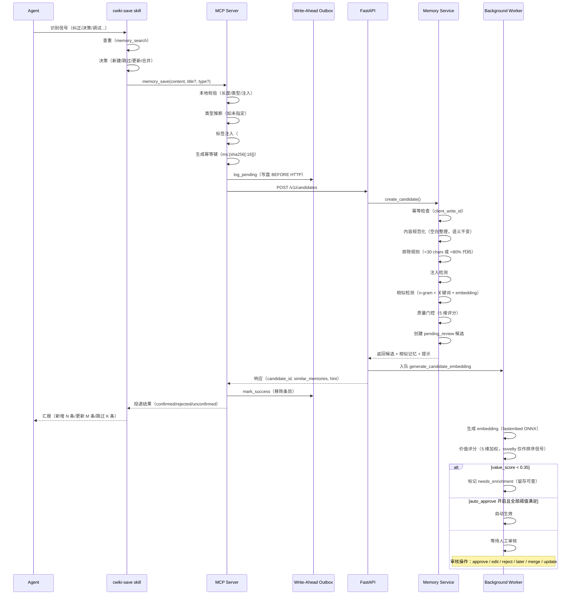
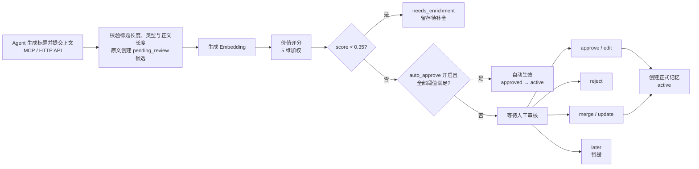
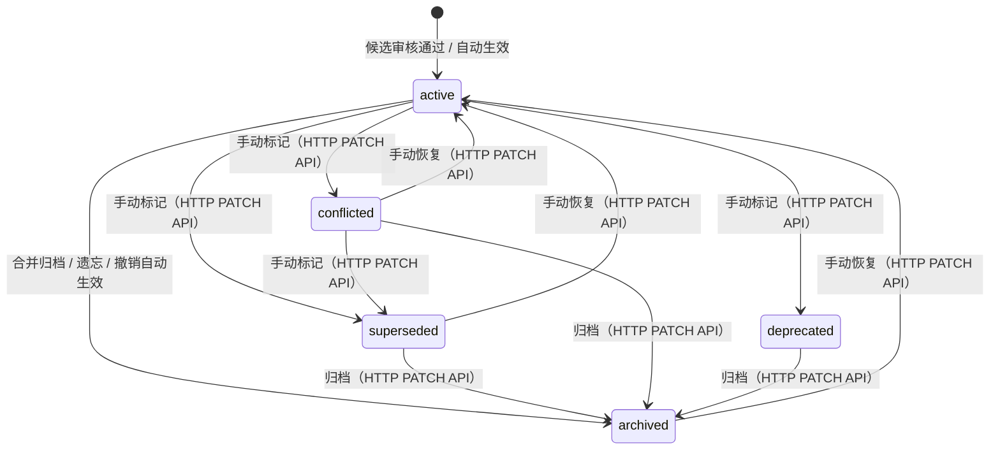
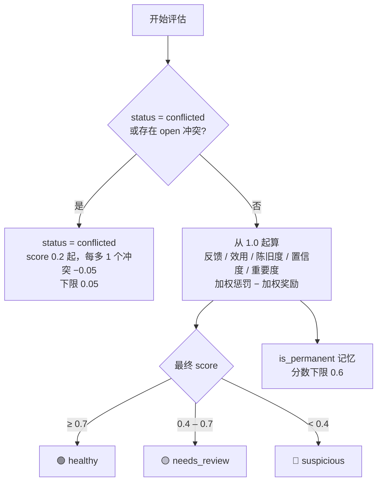

# 记忆系统

## 端到端写入流程



### 关键保障

- **Write-Ahead Outbox**：HTTP 调用前写盘，崩溃后自动重放，确保不丢失
- **幂等写入**：相同内容的重试返回已有候选，不重复创建
- **两层去重**：Agent 端主动搜索 + Server 端相似检测
- **质量门控**：5 维评分决定审核优先级；价值分过低标记为 `needs_enrichment`，物理行保留

---

## 写入契约

### 基本规则

- `memory_save(title=..., content=...)` 自动推断类型；传入 `type` 则使用指定分类。**正文语义原样保存**，不自动摘要化或调用 LLM 扩写；服务端仅做 Markdown 空白规范化（去除行尾空白、合并多余空行、标题前留空行、末尾单换行），不改变内容含义。
- Agent 必须概括主题生成并显式传入 `title`；标题最大长度默认 80 个字符（`config.yaml` 的 `memory.title_max_length`）。MCP 不自动生成标题或添加临时前缀。
- 类型必须有效，正文须满足 `len(content.strip()) >= 20`（去除首尾空白后至少 20 个字符）。`strip()` 仅用于校验，不改写存储内容。
- **排除规则**：服务端会拒绝 `len(content.strip()) < 30` 或代码行占比 >80% 的内容（认为可从代码/git 直接推导）。
- **永久声明**：`memory_save` 可传 `is_permanent=true`（可附 `permanent_reason`），候选审批通过后正式记忆继承该标记。永久记忆不参与自动衰减与自动合并归档；自动合并分组若包含永久记忆，只保留建议、不自动执行。
- 正文必须使用 Markdown 格式，不要求固定标题、段落或顺序。`memory_types` 提供类型列表供分类参考，不是提交前置步骤。
- 标题和展示预览的长度约束不代表正文篇幅限制，也不会截短正文；不能用标题代替正文。

### 更新语义

- `memory_update` / HTTP `PATCH /v1/memories/{id}` 只更新传入的字段，未提供的字段保持不变。
- 提供 `title` / `content` 时分别应用相同的标题长度上限与 `len(content.strip()) >= 20` 限制。
- `content` 是**整体正文替换**，不是追加或局部补丁，需提供保留有效细节的完整新版正文。只改元数据时不传 `content`。

### 安全与审核

安全检查和审核仍然保留；提交创建 `pending_review` 候选，不等于已批准的正式记忆。候选按三档策略处理（自动生效 / 人工审核 / 低分留存），详见[候选记忆流水线](#候选记忆流水线)。

> 提取质量、查重更新与检查点使用策略统一维护在 [cwiki-save skill](../skills/cwiki-save/SKILL.md)；MCP、AGENTS 与 skill 的职责见[架构设计](architecture.md#记忆写入与-agent-职责)。

### 写入决策（write_decisions）

`config.yaml` 的 `agent_policy.write_decisions` 决定“是否写入/更新/强制审核/拒绝”，在候选创建前执行；下面的 `memory.write_policy` 只决定候选创建后的审核方式。默认配置按“先拦截、再准入、按类型归类”拆成 8 条规则，覆盖全部 11 种记忆类型：

```yaml
agent_policy:
  write_decisions:
    enabled: true
    default_action: write   # write | skip
    rules:
      - id: skip-credentials
        action: skip         # write | skip | update
        description: 凭据、密钥、令牌与未脱敏日志不写入
        examples: ["api_key=sk-...", "Bearer eyJhbGci..."]
        match:
          keyword: ["password=", "api_key=", "-----BEGIN"]
      - id: must-save-signals
        action: write
        description: 用户纠正、明确偏好、强制规则必须记录
        examples: ["不要这样做，改用 X", "以后都按这个约定"]
        match:
          type: [feedback, rule]
      # …其余规则按 decision / issue+lesson / convention+pattern+constraint /
      #   fact+reference+procedure 分类，均为 type 匹配
```

- **管理界面**：配置页「写入管理 → 写入规则」支持分组编辑、组内排序、标签式匹配值输入与草稿预校验；改动先保存在浏览器草稿，点击“保存规则”才写入 `config.yaml` 并即时重载。
- **注入预览**：`POST /v1/config/write-decisions/preview` 按草稿生成真实的 SessionStart 摘要，支持传入 `workspace` 模拟工作区过滤，并返回字符预算（`length/max_chars`）、已展示/总规则数与截断标记；界面据此显示预算进度条与“未展示规则”提示。
- **硬限制**：规则 ≤ 30 条，说明 ≤ 300 字符，示例 ≤ 5 条且单条 ≤ 120 字符，匹配值每个维度按类型 ≤ 20/30 个且单值 ≤ 100 字符，注入摘要 ≤ 800 字符。服务端在 `GET/PUT /v1/config/write-decisions` 的 `limits` 字段中返回同一组数值，供前端计数与保存前校验。

- **分工**：`write_decisions` 是准入（是否写/更新），`write_policy` 是写入后的审核（auto/review/reject）。两者可同时命中；需要“写入但人工审核”时用 write_policy 的 `review`。
- **匹配**：固定优先级“不写入 > 更新 > 写入”，同组内按声明顺序；未命中用 `default_action`（write/skip）。`description/examples` 只注入 SessionStart，`match` 由服务端执行。
- **action**：
  - `write`：正常准入。
  - `skip`：4xx 拒绝，不创建候选。
  - `update`：找到相似度 ≥ 0.85 的正式记忆时返回 409，提示用 `memory_update` 更新目标；找不到目标则回退 `default_action`。
- **注入与复核**：SessionStart 注入规则摘要；`memory_save` 时服务端复核。被 skip/update 拒绝的响应带 `write_decision` 结构（规则 id、动作、目标记忆），MCP 会原样回显。无 hook 的宿主只能获得服务端复核。
- **审计**：write 候选带 `decision_rule_id` / `decision_action` / `decision_reason`；skip/update 不创建候选。
- **边界**：`enabled=false` 完全无行为变化；`memory_update`、HTTP PATCH、ZIP 导入、文件 API 直接创建不走准入；旧 `agent_policy.must_save` 仅在未配置 `write_decisions` 时合成等价 write 规则。

### 写入策略（write_policy）

`config.yaml` 的 `memory.write_policy` 在候选创建阶段按规则决定处理方式，配置默认关闭：

```yaml
memory:
  write_policy:
    enabled: true
    rules:
      - id: pinned-auto
        action: auto            # auto | review | reject
        reason: 用户指定长期保留
        match:
          workspace: cwiki      # 工作区名称或 UUID；省略 = 不限
          type: [decision, lesson]   # 字符串或列表
          tags: ["pinned"]          # 必须全部存在
          keyword: ["必须保留", "口径"]  # 标题/正文包含任一即可
```

- **匹配语义**：同一条规则内各字段是 AND；`type` / `workspace` / `keyword` 多值任一命中，`tags` 需全部存在。`keyword` 大小写不敏感，匹配标题 + 正文。规则按声明顺序匹配，命中第一条即停止。
- **action**：
  - `auto`：评分任务完成后自动生效，跳过价值分/置信度/质量门阈值；仍要求无 open 冲突，且已知重复概率 `< 0.95`。
  - `review`：强制人工审核，即使 `auto_approve_enabled=true` 也不会自动生效。
  - `reject`：创建候选前直接拒绝（HTTP 4xx），不落候选行；MCP outbox 标记为 rejected，不自动重试。
- **审计**：命中的规则 id、动作与原因写入候选的 `policy_rule_id` / `policy_action` / `policy_reason`；策略自动生效的 Review 使用 `reviewer_id="write_policy"`，`reason` JSON 含 `policy_rule`。
- **生效时机**：策略在 API 进程内执行，修改 `config.yaml` 后需重启后端（`python tasks.py restart`）；MCP 进程的配置热刷新不会更新 API 侧规则。
- **边界**：策略只作用于候选创建路径（`memory_save`、`memory_checkpoint`、episode 候选与 API `POST /v1/candidates`）；ZIP 导入、文件 API 直接创建记忆、重建不经过策略。非法规则会告警并跳过，不影响其他规则与服务启动；没有任何匹配条件的规则会匹配全部候选，配置时需谨慎。

---

### 投递与恢复

`memory_save` 通过本地校验后先写 outbox，再解析工作区与请求 API。只有 API 确认后才移除条目；本地校验、写盘失败不能称为已缓存。

| 响应字段 | 含义 |
|----------|------|
| `delivery: confirmed` | 已接收候选（不是已批准） |
| `cached: true` | 正文已暂存 |

恢复状态统一查看 `outbox_counts`（`pending`、`failed`、`exhausted`、`rejected`）及 `outbox_total`，统计范围是本地所有工作区。

> 兼容字段 `outbox_pending` 在 save/retry 为 failed+exhausted，在 status 仅为 failed，不能当作总数。

确定性拒绝和重试耗尽保留原文与错误，不再在启动时自动删除；修复原因后显式重试，并检查逐条结果。

**更新操作**不具有相同的离线 outbox 保证。`memory_update` 超时后先读取当前正文和版本，避免重复修改；支持 `expected_version` 时带上旧版本，冲突时重新读取再合并。审核合并、候选更新和直接编辑均保存修改前的版本快照。

---

## 工作区（workspace）概念

workspace 是**宿主当前绑定项目**的知识容器，也是唯一的组织维度：

- **来源**：宿主绑定项目推导。优先级：安装器显式写入的 `CWIKI_WORKSPACE` > 项目目录 env（`CWIKI_WORKSPACE_DIR`/`CWIKI_PROJECT_DIR`/`QODER_PROJECT_DIR`…）> 进程 CWD；CWD 等于 cwiki 仓库或 home 时视为"宿主未传项目"，回落 `default`。dsh 不下发 roots、也不导出项目目录 env，其归属只能靠安装器写入。
- **清洗规则**：目录名只保留 `A-Za-z0-9._-`；以下形态一律拒绝并回落 `default`——8 位十六进制哈希名（如 `179cf7e8`，Qoder 会话 ID 截断误传）、路径编码名（`C--Users-…`、`--Users-…--`，宿主把会话路径当目录名传入）、含折叠连字符的名字、首字符非字母数字的名字（`.`/`..`/`.hidden`）。判据集中在 `adapters/hooks/profiles.clean_workspace_name`，由 hook、MCP 核心与安装器三处同源复用，不再产生垃圾工作区。
- **历史治理**：`GET /v1/workspaces/hygiene/preview` 预览脏名工作区，`POST /v1/workspaces/hygiene/merge` 一次性归并（迁移记忆/笔记/会话后删除源工作区）。
- **严格模式**：`memory.auto_create_workspace`（仓库 config.yaml 默认 `false`）为 false 时，未知名称直接返回 400 `unknown_workspace` 并附创建指引，不再静默建区；`default` 与 hook 捕获端点（`/v1/integrations/agent/capture`，名称由 cwd 派生）例外，仍可自动创建。

## 多标签系统

记忆支持多标签分类，标签在写入时自动规范化并持久化到 Markdown frontmatter：

- **规范化规则**：所有写入路径（MCP `memory_save`/`memory_update`、API 候选创建、审批）统一调用 `normalize_tags`——去前后空白、转小写、去重、过滤空串，保持首次出现顺序
- **存储格式**：SQLite `tags` 列（JSON 数组）+ Markdown frontmatter `tags: ["tag1", "tag2"]`
- **检索过滤**：`memory_search` 支持 `tags` 参数，按标签交集过滤（记忆必须包含所有指定标签）
- **审批继承**：候选审批为正式记忆时，标签原样复制（已在候选创建时规范化）
- **持久化全链路**：`file_sync`（MD 镜像）、`migrate_to_git`（数据同步）、`rebuilder`（DB 重建）、`export_import`（导出/导入）均保留标签

示例 frontmatter：

```yaml
---
id: 550e8400-e29b-41d4-a716-446655440000
title: Python 异步测试约定
type: fact
tags: ["python", "testing", "asyncio"]
source: mcp
status: active
confidence: 0.8
importance: 0.7
version: 1
is_permanent: false
created_at: 2026-10-20T10:00:00
updated_at: 2026-10-20T10:00:00
---
```

## 记忆生命周期

### 候选记忆流水线



#### 三档审核（自动生效 / 人工 / 低分留存）

评分落定后按 `memory.auto_approve_*` 配置分三档处理（`auto_approve_enabled` 默认关）：

- **自动生效**：须同时满足全部阈值——`value_score ≥ 0.85`、`confidence ≥ 0.80`、`quality_gate_score ≥ 0.75`、`duplicate_probability < 0.40` 且无 open 冲突指向该候选；重复概率必须已知，缺少 embedding 时不自动生效。执行时写入 `Review(reviewer_type="system", action="auto_approve")` 留痕（各分项与阈值存 reason JSON），创建正式记忆并同步 Markdown、入队生成向量。可撤销：revert 后记忆归档（archived），候选保持 `approved`，记忆可通过 PATCH 恢复为 `active`。
- **人工审核**：其余 `pending_review` 候选等待 approve / edit / reject / later / merge / update；批量审核仅支持 approve / reject / later。
- **低分留存**：价值分 < 0.35 的候选标记 `needs_enrichment`，不物理删除，也不进入 `pending_review` 队列；可通过 `POST /v1/candidates/{id}/restore` 恢复为 `pending_review`，再人工审核或编辑后批准。

`reject` 将候选标记为 `rejected`，`later` 标记为 `deferred`；`rejected`、`deferred`、`needs_enrichment` 以及历史状态 `quarantined` / `discarded` 都可通过 `POST /v1/candidates/{id}/restore` 回到 `pending_review`。拒绝为软留存，服务重启不会删除候选行。

每条候选的审核决策（含系统自动决策）都留 `Review` 记录。批准后会同步 Markdown、入队生成向量、创建初始复习计划，并尝试自动检测关系与写时冲突（失败不阻断审核）；正式记忆的编辑、合并会保留修改前快照，重建数据库时随 `_meta` 完整恢复。

### 检查点的覆盖边界

`memory_checkpoint` 对已采集事件和会话笔记做有限的规则提取，不读取完整宿主对话，也不执行完整对话的语义检查：

- 事件默认查询最近 60 分钟，后续可按上次检查点调整窗口（5 分钟至 24 小时）；事件和笔记各最多读取 200 条。实际范围见响应 `input_window`，输入可用性见 `input_status`。
- 候选使用所获取的 `prompt` 全文、笔记原文；错误候选保留 `error` 全文并附带工具上下文，不以截短片段代替正文。
- 默认提交候选；`dry_run=true` 只返回分析与预览、不提交。
- 部分输入、提交失败或读取达到上限会报告 `partial`，不推进水位；事件与笔记都不可用则报告 `error`。
- Qoder 插件提供的是静态保存提醒，不读取或上传会话正文。只有外部通过事件/笔记接口采集的内容才可被检查点读取。

> 何时调用检查点、如何查重和补充遗漏，统一遵循 [cwiki-save skill](../skills/cwiki-save/SKILL.md)。

### 正式记忆演化



- HTTP API `PATCH /v1/memories/{id}` 的 `status` 会经过状态转换校验，非法转换返回 409。允许的转换：`active → superseded / conflicted / archived / deprecated`、`superseded → active / archived`、`conflicted → active / superseded / archived`、`archived → active`、`deprecated → archived`（要恢复需先归档再激活）。
- 记忆间合并（源记忆归档）、自动整合、撤销自动生效和 `memory_forget` 属于内部路径，直接写 `archived`，不经过 PATCH 的状态转换校验。
- MCP `memory_update` 未声明 `status` 参数；`memory_forget` 是归档（软删除）入口，不能将 HTTP API 的能力视为 MCP 声明的契约，以实际 `tools/list` 为准。
- `archived` 由合并产生（手动合并、自动整合的源记忆归档），也可通过 HTTP PATCH API 手动设置；`deprecated`、`superseded` 和 `conflicted` 当前无自动触发逻辑，仅通过 HTTP PATCH API 手动设置。冲突本身记录在 `MemoryConflict`，创建 open 冲突不会自动改记忆状态，但会计入健康度。
- 归档记忆的向量会被回收：状态离开 `active` 时向量从内存索引与 `vectors.npz` 移除并持久化，文件镜像同步归档状态；恢复为 `active` 时若仍有 embedding 则回填向量并持久化，embedding 缺失则由 `generate_embedding` 任务重嵌。启动扫描（`sync_all`）与文件监听（watchdog）遵循同一语义：归档文件不重建向量，残留向量被剪枝。

### 健康状态机

健康度由 `compute_health` 在查询时实时计算，不写回记忆状态。先做冲突硬拦截，再对其余信号做加权合并。



> 惩罚项按权重加权平均后合并，不是逐项直接相减；奖励项（高置信度、高重要度）会抵消部分惩罚。

### 后台演化任务

任务注册在进程内任务队列；API 启动时按配置启动周期调度器，定期触发自动整合、复习提醒和 `_meta` 导出。复习提交、候选入库等仍为事件驱动。

| 任务 | 触发方式 | 动作 |
|------|----------|------|
| 整合相似记忆 | 周期调度（`auto_consolidate_enabled` 开启时，默认每 6 小时）或手动入队（`POST /v1/memories/consolidate`） | BM25 预过滤 + Jaccard/embedding 验证生成合并建议；`auto_merge_enabled` 开启时对高相似组（≥ `auto_merge_threshold`，默认 0.92）自动合并——先提交持久化，再收敛文件镜像与向量：源记忆归档并回收向量，keeper 旧向量移除后由 `generate_embedding` 任务重嵌 |
| 复习提醒 | 周期调度（`review_reminders_enabled` 开启时，默认每 24 小时） | 扫描到期的 `ReviewSchedule`，按工作区把提醒摘要写入状态文件 |
| 定期 `_meta` 导出 | 周期调度（`meta_export_interval_hours`，默认 12 小时） | 导出 `_meta` JSON，供 Git 同步与数据库重建 |
| 间隔重复 | 复习提交时同步更新 | SM-2 算法更新复习间隔与掌握度等级（`python tasks.py recompute` 可重放 review_history 重建调度） |
| 去重检测 | 新候选入库时自动触发 | Embedding 余弦相似度比对（列级 select 避免加载无关列） |
| 批量 Embedding | 手动入队 / 孤儿恢复触发 | 一次性收集缺失 embedding 的待审候选，fastembed 本地 ONNX 批量生成 |

---

## 评分体系

### 记忆质量门控（Quality Gate）

候选记忆入库前评估，5 个维度各 0.0-1.0，取平均得到质量分：

| 维度 | 说明 | 评分要点 |
|------|------|----------|
| `stable` | 信息是否长期有效 | 类型基础分（constraint 0.9 / rule、decision 0.85 / convention 0.8 / fact、reference 0.5）；内容 >100 / >300 字各 +0.05；含绝对化措辞 +0.05；含版本号 −0.05 |
| `reusable` | 能否跨会话复用 | 基础 0.4；跨上下文关键词 +0.15；>80 / >200 / >500 字分别 +0.1 / +0.1 / +0.05；含代码或示例各 +0.1；<20 字直接 0.2 |
| `actionable` | 是否提供可执行指引 | 动作词基础 0.3，每个 +0.1，上限 0.7；列表 +0.15、代码 +0.1、标题 +0.05；条件从句 +0.1；Why/How 同时出现 +0.15，只出现一个 +0.05 |
| `scoped` | 范围是否恰当 | <10 / <20 / <50 字分别为 0.1 / 0.3 / 0.6；Markdown 标题行超过 5 个 0.5；其余 0.85 |
| `evidence_backed` | 证据是否充分 | 外部证据 3 / 2 / 1 条分别为 1.0 / 0.8 / 0.55；正文内证 2 / 1 项为 0.6 / 0.4；signal_type 映射（correction 0.8 / debug_resolution 0.75 / decision 0.65 / pattern 0.6 / fact 0.5 / other 0.3）；都没有时 0.2 |

质量分 → 审核优先级（质量越高，所需审核力度越小）：

| 质量分 | review_priority |
|--------|-----------------|
| ≥ 0.8 | 0.2（快速通过） |
| 0.6 – 0.8 | 0.5 |
| 0.4 – 0.6 | 0.7 |
| < 0.4 | 0.9（严格审核） |

> 五个维度的方差 > 0.04 时，`review_priority` 再 +0.1（上限 1.0），表示各维度表现悬殊、评分不稳定。

### 记忆价值评分（Value Score）

候选记忆的加权综合评分，用于优先级分类和低分留存：

```
value_score = 0.25 × reusability       # 可复用性
            + 0.20 × stability         # 稳定性
            + 0.20 × confidence        # 置信度
            + 0.20 × importance        # 重要性
            + 0.15 × evidence_strength # 证据强度
```

各维度缺失时，评分任务按 0.5 回填后计算。优先级分类：

| value_score | 优先级 | 处理 |
|-------------|--------|------|
| < 0.35 | `needs_enrichment` | 低分留存，不进入人工审核队列 |
| 0.35 – 0.65 | `low_priority` | 低优先级队列 |
| 0.65 – 0.85 | `normal` | 正常审核队列 |
| ≥ 0.85 | `high_value` | 高价值优先 |

> **novelty** 由 embedding 余弦相似度计算：`novelty = 1.0 − max(cosine_sim(candidate, existing))`。当前只用于候选排序和 `duplicate_probability`（`1 − novelty`），不参与 `value_score`。

### 记忆效用评分（Utility Score）

已入库记忆根据实际使用情况计算：

```
utility = 0.30 × retrieval_success   # 检索成功率（used / retrieved）
        + 0.25 × agent_usage         # Agent 引用率（cited / retrieved）
        + 0.20 × human_feedback      # 有用票占比，无反馈时 0.5
        + 0.15 × freshness           # 新鲜度
        + 0.10 × evidence_strength   # 证据强度（证据数 / 5，封顶 1）
```

新鲜度：从未使用为 0.3；最近使用在 1 / 7 / 30 / 90 天内分别为 1.0 / 0.9 / 0.7 / 0.5，超过 90 天为 0.2。开启掌握度耦合衰减后，上述天数按 `1 + ln(max(ease_factor, 1.3))` 放大。

**使用流水 stage 语义**：`/v1/search` 命中记 `retrieved`；`/v1/context`（curated 交付）记 `used`；`POST /v1/feedback` 且 `feedback_type=useful` 时补记 `cited`。`retrieval_success` 与 `agent_usage` 由此获得真实分母/分子。`evidence_strength` 统一取 `evidence` 表计数（与列表页、健康摘要同口径）。

### 健康状态

健康评估不写回记忆状态，查询时实时计算。存在 open 冲突时直接返回 `conflicted`：分数从 0.2 起，每多一个冲突再减 0.05，下限 0.05。

其余情况从 1.0 起算，按下表信号做**加权平均**合并（权重在括号内），高置信度/高重要度会形成奖励并抵消部分惩罚：

| 信号 | 权重 | 计算方式 |
|------|------|----------|
| 人工反馈 | 3.0 | 对「无用」占比做拉普拉斯平滑，超过 40% 才开始惩罚，并按样本量折扣 |
| 效用分 | 3.0 | 低于 0.5 基线时按距离惩罚 |
| 陈旧度 | 2.5 | 连续衰减；半衰期默认 90 天，掌握度耦合模式下随 EF 对数增长；从未使用则从创建 30 天后开始爬升 |
| 置信度 | 2.0 | 以 0.5 为中心，低于 0.5 惩罚、高于 0.5 奖励 |
| 重要度 | 1.5 | 以 0.5 为中心，低于 0.5 惩罚、高于 0.5 奖励 |

`is_permanent` 记忆的分数下限为 0.6。

**最终状态**：

| 状态 | 分数区间 | 含义 |
|------|----------|------|
| 🟢 `healthy` | ≥ 0.7 | 正常使用 |
| 🟡 `needs_review` | 0.4 – 0.7 | 需要关注 |
| 🔴 `suspicious` | < 0.4 | 可疑，建议审核 |
| 🟣 `conflicted` | 硬性拦截 | 状态为 conflicted 或存在 open 冲突 |

## 配置速查（P0–P3 打磨新增）

| 配置 | 默认 | 作用 |
|------|------|------|
| `memory.auto_create_workspace` | 代码 true / 仓库 false | 未知工作区是否自动建区；capture 端点例外 |
| `memory.duplicate_exact_threshold` / `duplicate_possible_threshold` | 0.85 / 0.6 | 重复分类阈值（运行时读取，改配置即生效） |
| `memory.submit_dedup_scan_limit` / `submit_dedup_cross_workspace` | 1000 / false | 提交时查重的扫描范围与是否跨工作区 |
| `mcp.max_retries` / `mcp.retry_backoff_seconds` | 2 / 1.0 | MCP 适配器调用后端时的重试次数与退避基数 |
| `parasitic_evolution.relation_auto_edge_ttl_days` | 0（关闭） | auto 边超过 N 天且从未强化、低置信时由巡检任务清理 |
| `scheduler.relation_ttl_check_interval_hours` | 24 | 关系老化巡检间隔 |

相关能力：

- `python tasks.py doctor`：DB / Markdown / `_meta` / 索引 / 向量一致性巡检（见开发指南）。
- `POST /v1/memories/merge-suggestions/dismiss`：忽略合并建议，状态存 `~/.cwiki/state/consolidation_dismissed.json`（可用 `CWIKI_STATE_DIR` 重定位）。
- `memory_search mode=semantic`：仅向量路，过滤/重排与 hybrid 一致；`curated=true` 的 limit 超过 50 会夹紧到 50。
- 质量分布页分箱可下钻：`/memories?usage=…&decay=…&min_confidence=…&min_importance=…`。
