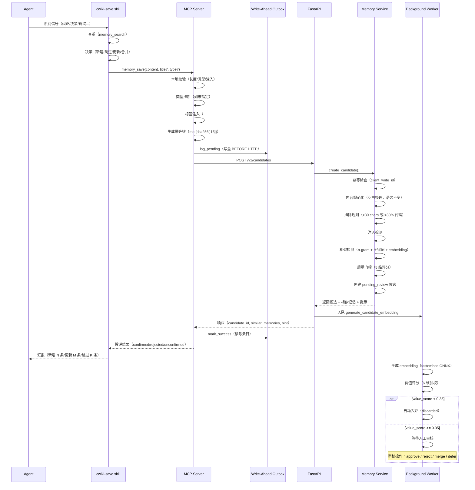
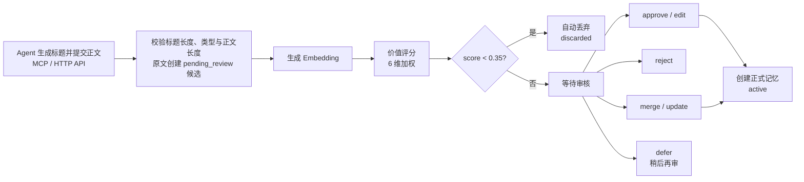
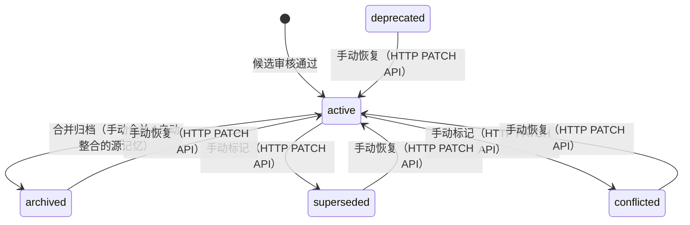
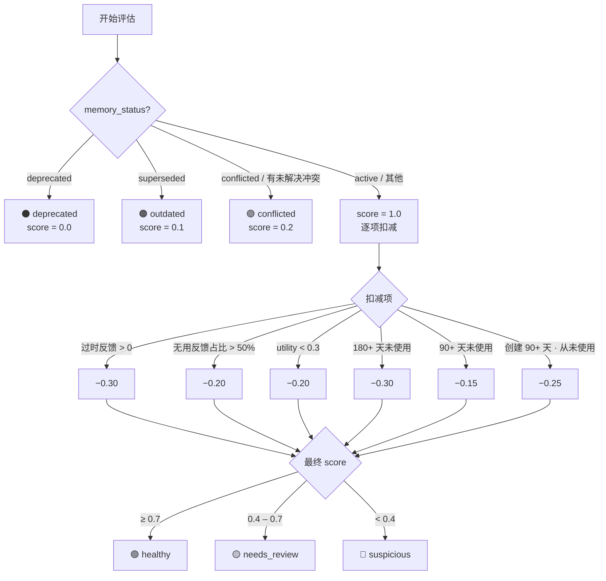

# 记忆系统

## 端到端写入流程



### 关键保障

- **Write-Ahead Outbox**：HTTP 调用前写盘，崩溃后自动重放，确保不丢失
- **幂等写入**：相同内容的重试返回已有候选，不重复创建
- **两层去重**：Agent 端主动搜索 + Server 端相似检测
- **质量门控**：5 维评分决定审核优先级，低价值自动丢弃

---

## 写入契约

### 基本规则

- `memory_save(title=..., content=...)` 自动推断类型；传入 `type` 则使用指定分类。**正文语义原样保存**，不自动摘要化或调用 LLM 扩写；服务端仅做 Markdown 空白规范化（去除行尾空白、合并多余空行、标题前留空行、末尾单换行），不改变内容含义。
- Agent 必须概括主题生成并显式传入 `title`；标题最大长度默认 80 个字符（`config.yaml` 的 `memory.title_max_length`）。MCP 不自动生成标题或添加临时前缀。
- 类型必须有效，正文须满足 `len(content.strip()) >= 20`（去除首尾空白后至少 20 个字符）。`strip()` 仅用于校验，不改写存储内容。
- **排除规则**：服务端会拒绝 `len(content.strip()) < 30` 或代码行占比 >80% 的内容（认为可从代码/git 直接推导）。
- 正文必须使用 Markdown 格式，不要求固定标题、段落或顺序。`memory_types` 提供类型列表供分类参考，不是提交前置步骤。
- 标题和展示预览的长度约束不代表正文篇幅限制，也不会截短正文；不能用标题代替正文。

### 更新语义

- `memory_update` / HTTP `PATCH /v1/memories/{id}` 只更新传入的字段，未提供的字段保持不变。
- 提供 `title` / `content` 时分别应用相同的标题长度上限与 `len(content.strip()) >= 20` 限制。
- `content` 是**整体正文替换**，不是追加或局部补丁，需提供保留有效细节的完整新版正文。只改元数据时不传 `content`。

### 安全与审核

安全检查和人工审核仍然保留；提交创建 `pending_review` 候选，不等于已批准的正式记忆。候选按三档策略处理（自动生效 / 人工审核 / 隔离留存），详见[候选记忆流水线](#候选记忆流水线)。

> 提取质量、查重更新与检查点使用策略统一维护在 [cwiki-save skill](../skills/cwiki-save/SKILL.md)；MCP、AGENTS 与 skill 的职责见[架构设计](architecture.md#记忆写入与-agent-职责)。

---

### 投递与恢复

`memory_save` 通过本地校验后先写 outbox，再解析工作区与请求 API。只有 API 确认后才移除条目；本地校验、写盘失败不能称为已缓存。

| 响应字段 | 含义 |
|----------|------|
| `delivery: confirmed` | 已接收候选（不是已批准） |
| `cached: true` | 正文已暂存 |

恢复状态统一查看 `outbox_counts`（`pending`、`failed`、`exhausted`、`rejected`）及 `outbox_total`，统计范围是本地所有工作区。

> 兼容字段 `outbox_pending` 在 save/retry 为 failed+exhausted，在 status 仅为 failed，不能当作总数。

确定性拒绝和重试耗尽保留原文与错误，不再在启动时自动删除；修复原因后显式重试，并检查逐条结果。

**更新操作**不具有相同的离线 outbox 保证。`memory_update` 超时后先读取当前正文和版本，避免重复修改；支持 `expected_version` 时带上旧版本，冲突时重新读取再合并。审核合并、候选更新和直接编辑均保存修改前的版本快照。

---

## 记忆生命周期

### 候选记忆流水线



#### 三档审核（自动生效 / 人工 / 隔离）

评分落定后按 `memory.auto_approve_*` 配置分三档处理（`auto_approve_enabled` 默认关，灰度验证后放开）：

- **自动生效**：须同时满足全部阈值——`value_score ≥ 0.85`、`confidence ≥ 0.80`、`quality_gate_score ≥ 0.75`、`duplicate_probability < 0.40` 且无 open 冲突指向该候选。执行时写入 `Review(reviewer_type="system", action="auto_approve")` 留痕（各分项与阈值存 reason JSON），并创建正式记忆。可撤销：revert 后记忆归档（archived），恢复即重新激活。
- **人工审核**：其余 `pending_review` 候选等待 approve / edit / reject / merge / defer。
- **隔离**：评分过低的 discard 分支不再物理删除，标记 `quarantined` 留存——可查看、可恢复为 `pending_review`；CONFLICT 候选入隔离时对应 MemoryConflict 保持 open。`reject` 同样为隔离留存（`rejected` 状态，行不删除可恢复）。

每条候选的审核决策（含系统自动决策）都留 `Review` 记录，版本快照写入 MemoryVersion，重建数据库时随 `_meta` 完整恢复。

### 检查点的覆盖边界

`memory_checkpoint` 对已采集事件和会话笔记做有限的规则提取，不读取完整宿主对话，也不执行完整对话的语义检查：

- 事件默认查询最近 60 分钟，后续可按上次检查点调整窗口（5 分钟至 24 小时）；事件和笔记各最多读取 200 条。实际范围见响应 `input_window`，输入可用性见 `input_status`。
- 候选使用所获取的 `prompt` 全文、笔记原文；错误候选保留 `error` 全文并附带工具上下文，不以截短片段代替正文。
- 默认提交候选；`dry_run=true` 只返回分析与预览、不提交。
- 部分输入、提交失败或读取达到上限会报告 `partial`，不推进水位；事件与笔记都不可用则报告 `error`。
- Qoder 插件提供的是静态保存提醒，不读取或上传会话正文。只有外部通过事件/笔记接口采集的内容才可被检查点读取。

> 何时调用检查点、如何查重和补充遗漏，统一遵循 [cwiki-save skill](../skills/cwiki-save/SKILL.md)。

### 正式记忆演化

下图展示已实现的操作与手动恢复示例，不是完整的自动状态机，连线也不代表状态转换约束。



- HTTP API `PATCH /v1/memories/{id}` 的 `status` 为可选字符串；传入非 `null` 值时直接赋值，当前没有状态枚举或转换关系校验。上述状态都不是不可逆终态，可手动重新设置。
- MCP `memory_update` 当前未声明 `status` 参数；不能将 HTTP API 的能力视为 MCP 声明的契约，以实际 `tools/list` 为准。
- `archived` 由合并产生（手动合并，或自动整合中源记忆归档），也可通过 HTTP PATCH API 手动设置；`deprecated`、`superseded` 和 `conflicted` 当前无自动触发逻辑，仅通过 HTTP PATCH API 手动设置。
- 归档记忆的向量会被回收：状态离开 `active` 时向量从内存索引与 `vectors.npz` 移除并持久化，文件镜像同步归档状态；恢复为 `active` 时若仍有 embedding 则回填向量并持久化，embedding 缺失则由 `generate_embedding` 任务重嵌。启动扫描（`sync_all`）与文件监听（watchdog）遵循同一语义：归档文件不重建向量，残留向量被剪枝。

### 健康状态机

健康度评估流程：优先级判定 → 分数扣减 → 状态分类。该流程本身不表示已配置定时调度。



> 扣减项可叠加，`score = max(计算值, 0.0)`。90 天和 180 天未使用互斥（取较重的一项）。优先级判定命中后直接返回固定分数，不进入扣减流程。

### 后台演化任务

演化任务已注册到进程内任务队列，但当前无定时调度器，需手动触发（间隔重复为复习提交时同步执行，见下表）。

| 任务 | 触发方式 | 动作 |
|------|----------|------|
| 整合相似记忆 | 手动入队（`POST /v1/memories/consolidate`） | BM25 预过滤 + Jaccard 验证生成合并建议；`auto_merge_enabled` 开启时对高相似组（≥ `auto_merge_threshold`，默认 0.92）自动合并——先提交持久化，再收敛文件镜像与向量：源记忆归档并回收向量，keeper 旧向量移除后由 `generate_embedding` 任务重嵌 |
| 间隔重复 | 复习提交时同步更新 | SM-2 算法更新复习间隔与掌握度等级（`python tasks.py recompute` 可重放 review_history 重建调度） |
| 去重检测 | 新候选入库时自动触发 | Embedding 余弦相似度比对（列级 select 避免加载无关列） |
| 批量 Embedding | 手动入队 / 孤儿恢复触发 | 一次性收集所有缺少 embedding 的记忆与候选，fastembed 本地 ONNX 批量生成 |

---

## 评分体系

### 记忆质量门控（Quality Gate）

候选记忆入库前评估，5 个维度各 0.0-1.0，取平均得到质量分：

| 维度 | 说明 | 评分要点 |
|------|------|----------|
| `stable` | 信息是否长期有效 | 类型基础分（constraint 0.9 / decision 0.85 / convention 0.8），内容 >100 字 +0.1 |
| `reusable` | 能否跨会话复用 | 内容长度梯度（>100 字 +0.15，>300 字 +0.1） |
| `actionable` | 是否提供可执行指引 | 动作词命中数（使用/避免/确保/检查…），每个 +0.15 |
| `scoped` | 范围是否恰当 | `len(content.strip()) < 20` 得 0.3，否则 0.8；不惩罚长文，不因含 `##` 加分 |
| `evidence_backed` | 证据是否充分 | 证据数 ≥3 → 1.0，signal_type 映射（correction 0.8 / debug_resolution 0.7） |

质量分 → 审核优先级（质量越高，所需审核力度越小）：

| 质量分 | review_priority |
|--------|-----------------|
| ≥ 0.8 | 0.2（快速通过） |
| 0.6 – 0.8 | 0.5 |
| 0.4 – 0.6 | 0.7 |
| < 0.4 | 0.9（严格审核） |

### 记忆价值评分（Value Score）

候选记忆的加权综合评分，用于优先级分类和自动丢弃：

```
value_score = 0.20 × novelty           # 新颖度（1 − max 余弦相似度）
            + 0.20 × reusability       # 可复用性
            + 0.15 × stability         # 稳定性
            + 0.15 × confidence        # 置信度
            + 0.15 × importance        # 重要性
            + 0.15 × evidence_strength # 证据强度
```

各维度缺失时默认 0.5。优先级分类：

| value_score | 优先级 | 处理 |
|-------------|--------|------|
| < 0.35 | `discard` | 自动丢弃 |
| 0.35 – 0.65 | `low_priority` | 低优先级队列 |
| 0.65 – 0.85 | `normal` | 正常审核队列 |
| ≥ 0.85 | `high_value` | 高价值优先 |

> **novelty** 由 embedding 余弦相似度计算：`novelty = 1.0 − max(cosine_sim(candidate, existing))`。无已有记忆时为 1.0，无 embedding 时默认 0.5。

### 记忆效用评分（Utility Score）

已入库记忆根据实际使用情况计算：

```
utility = 0.30 × retrieval_success   # 检索成功率
        + 0.25 × agent_usage         # Agent 使用频率
        + 0.20 × human_feedback      # 人类反馈
        + 0.15 × freshness           # 新鲜度
        + 0.10 × evidence_strength   # 证据强度
```

### 已验证记忆质量评分（Quality Scorer）

对已入库记忆的综合质量评估，5 个维度加权求和：

```
quality_score = 0.30 × confidence      # 置信度
              + 0.20 × usage_frequency  # 使用频率（90 天内）
              + 0.20 × freshness        # 新鲜度
              + 0.15 × review_status    # 审核状态
              + 0.15 × relation_count   # 关联数量
```

| 维度 | 权重 | 计算方式 |
|------|------|----------|
| `confidence` | 0.30 | 记忆自身的置信度值（默认 0.5） |
| `usage_frequency` | 0.20 | 90 天内使用次数 / 20（≥20 次满分） |
| `freshness` | 0.20 | 按新鲜度状态映射：fresh=1.0 / aging=0.6 / stale=0.2 / permanent=0.8 |
| `review_status` | 0.15 | active=1.0 / deprecated=0.3 / archived=0.0 |
| `relation_count` | 0.15 | 关联数 / 5（≥5 个关联满分） |

**新鲜度阈值**（按记忆类型区分）：

| 类型 | fresh | aging | stale |
|------|-------|-------|-------|
| `fact` | 7 天 | 30 天 | 90 天 |
| `convention` / `decision` / `procedure` / `reference` | 30 天 | 90 天 | 180 天 |
| `pattern` / `issue` / `feedback` | 14 天 | 60 天 | 120 天 |

### 健康状态

健康评估从 `score = 1.0` 出发，按负面信号逐项扣减，最终按分数区间划分状态。

**优先级判定**（命中即返回，不再计算分数）：

| 状态 | 分数 | 触发条件 |
|------|------|----------|
| ⚫ `deprecated` | 0.0 | `memory_status == "deprecated"` |
| 🟠 `outdated` | 0.1 | `memory_status == "superseded"` |
| 🟣 `conflicted` | 0.2 | `memory_status == "conflicted"` 或 `conflict_count > 0` |

**分数扣减**（适用于非优先级记忆，可叠加）：

| 扣减 | 条件 |
|------|------|
| −0.30 | 有过时反馈（`feedback_outdated > 0`） |
| −0.20 | 多数反馈为无用（`not_useful / total > 0.5`） |
| −0.20 | 效用分过低（`utility_score < 0.3`） |
| −0.30 | 超过 180 天未使用 |
| −0.15 | 超过 90 天未使用 |
| −0.25 | 创建超 90 天且从未使用（`usage_count == 0`） |

**最终状态**（按扣减后的分数）：

| 状态 | 分数区间 | 含义 |
|------|----------|------|
| 🟢 `healthy` | ≥ 0.7 | 正常使用 |
| 🟡 `needs_review` | 0.4 – 0.7 | 需要关注 |
| 🔴 `suspicious` | < 0.4 | 可疑，建议审核 |
