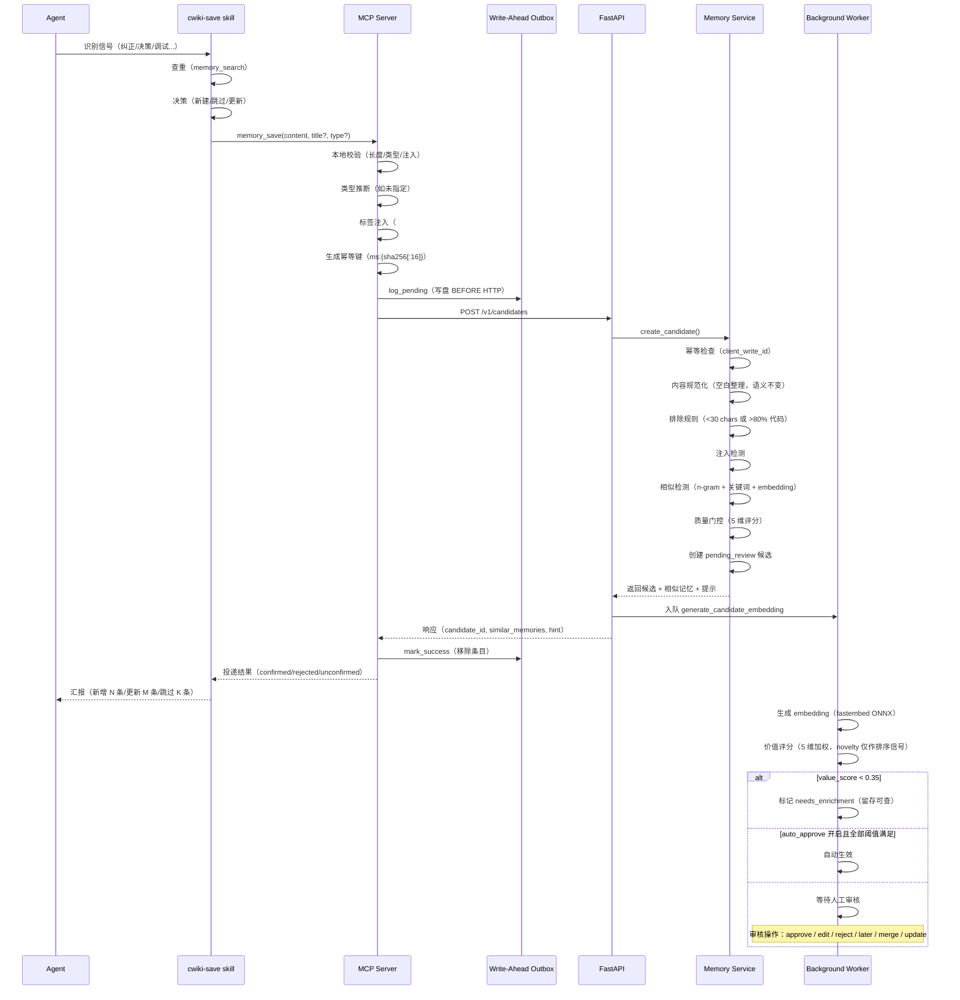
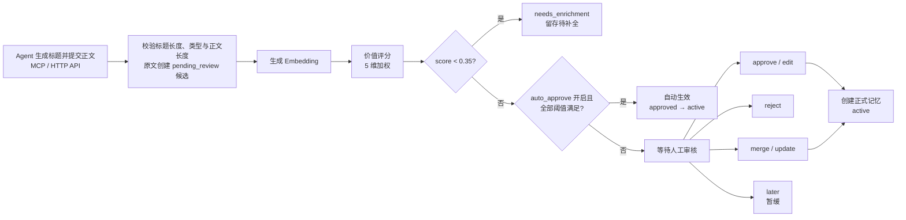
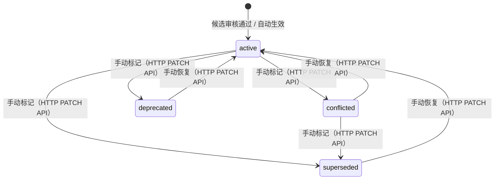
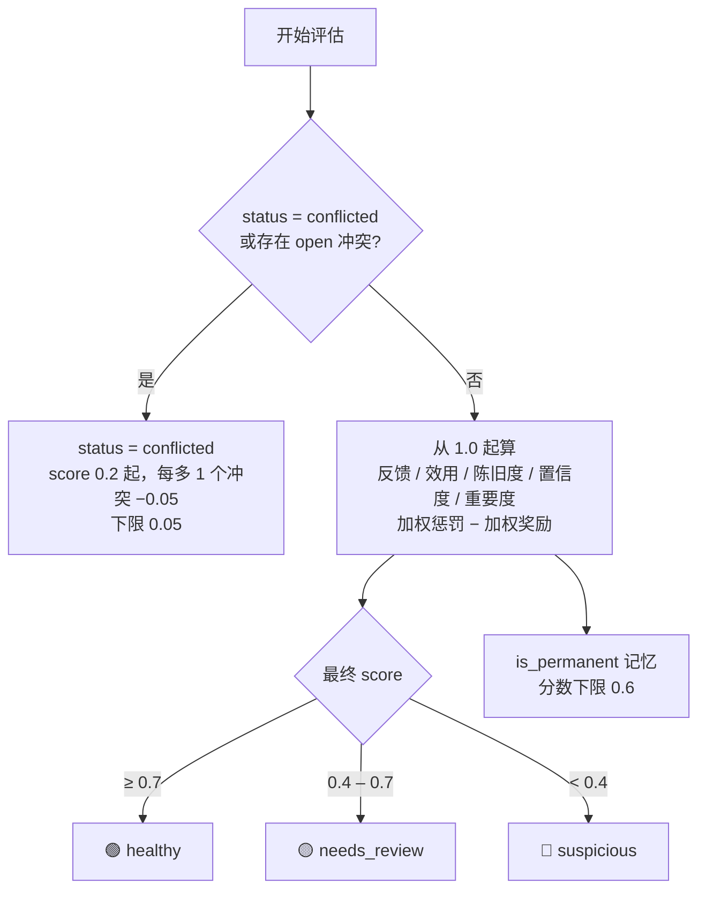

# 记忆系统

## 上下文质量验收

运行 `python -m benchmarks.runners.context_runner`，使用合成夹具与黄金候选池评估选择召回、负例排除、渲染 Token 预算和冲突告警；报告默认写入 `benchmarks/reports/eval-fixture/`。它不读取个人记忆库，夹具数据库以 SQLite 只读模式打开，结束或异常时释放连接。缺失数据库、候选池引用不存在的记忆、空黄金集均报错，不跳过后继续生成看似正常的报告；黄金集按 UTF-8 读取。

此运行器需在独立进程中执行，不能嵌入正在处理请求的服务并发调用：它暂时将相关性门限设为 `hard / 0.5`，以匹配手工分配的候选分数，退出时（包括异常）恢复原值。这不是生产配置的推荐阈值。

**结果边界**：该评估从预先给定的候选池开始，不能证明端到端检索召回、API 交付一致性、最终回答真实引用或任务成功率。冲突告警指标仅在含预期冲突对的样本上统计。合成数据满分不等于真实任务满分；真实验收仍需独立标注的问题、相关记忆与负例，并分别检查检索、交付和最终回答。

## 端到端写入流程



### 关键保障

- **写入 receipt**：MCP `memory_save` 响应中的 `receipt.delivery_status` 表示投递状态（`confirmed` / `queued` / `unconfirmed` / `rejected`），`candidate_status` 表示候选处理状态，`publication_status` 表示是否已成为正式记忆；HTTP 确认候选不代表正式发布。`replayed` 标记服务端幂等命中；失败时 `outbox_status` 说明本地待重试或已拒绝状态。旧版 `delivery`、`created` 字段保留兼容。
- **Write-Ahead Outbox**：HTTP 调用前写盘，崩溃后自动重放，确保不丢失
- **幂等写入**：相同内容的重试返回已有候选，不重复创建
- **两层去重**：Agent 端主动搜索 + Server 端相似检测
- **质量门控**：5 维评分决定审核优先级；价值分过低标记为 `needs_enrichment`，物理行保留
- **Capture 漏斗统计**：`GET /v1/integrations/agent/stats` 除总量和 formalization rate 外，返回 `notes_with_candidate`、`notes_discarded`、`oldest_pending_at`、`oldest_pending_age_days`；待整理统计排除已丢弃笔记，年龄按 UTC 计算。这些指标用于发现积压，不触发自动整理或删除。

---

## 写入契约

### 基本规则

- `memory_save(title=..., content=...)` 自动推断类型；传入 `type` 则使用指定分类。**正文语义原样保存**，不自动摘要化或调用 LLM 扩写；服务端仅做 Markdown 空白规范化（去除行尾空白、合并多余空行、标题前留空行、末尾单换行），不改变内容含义。
- Agent 必须概括主题生成并显式传入 `title`；标题最大长度默认 80 个字符（`config.yaml` 的 `memory.title_max_length`）。MCP 不自动生成标题或添加临时前缀。
- 类型必须有效，正文须满足 `len(content.strip()) >= 20`（去除首尾空白后至少 20 个字符）。`strip()` 仅用于校验，不改写存储内容。
- **排除规则**：服务端会拒绝 `len(content.strip()) < 30` 或代码行占比 >80% 的内容（认为可从代码/git 直接推导）。
- **永久声明**：`memory_save` 可传 `is_permanent=true`（可附 `permanent_reason`），候选审批通过后正式记忆继承该标记。永久记忆不参与自动衰减。
- 正文必须使用 Markdown 格式，不要求固定标题、段落或顺序。`memory_types` 提供类型列表供分类参考，不是提交前置步骤。
- 标题和展示预览的长度约束不代表正文篇幅限制，也不会截短正文；不能用标题代替正文。

### 更新语义

- `memory_update` / HTTP `PATCH /v1/memories/{id}` 只更新传入的字段，未提供的字段保持不变。
- 提供 `title` / `content` 时分别应用相同的标题长度上限与 `len(content.strip()) >= 20` 限制。
- `content` 是**整体正文替换**，不是追加或局部补丁，需提供保留有效细节的完整新版正文。只改元数据时不传 `content`。

### 安全与审核

安全检查和审核仍然保留；提交创建 `pending_review` 候选，不等于已批准的正式记忆。候选按三档策略处理（自动生效 / 人工审核 / 低分留存），详见[候选记忆流水线](#候选记忆流水线)。

> 提取质量、查重更新与检查点使用策略统一维护在 [cwiki-save skill](../skills/cwiki-save/SKILL.md)；MCP、AGENTS 与 skill 的职责见[架构设计](architecture.md#记忆写入与-agent-职责)。

### 写入决策（write_decisions）

`config.yaml` 的 `agent_policy.write_decisions` 决定“是否写入/更新/强制审核/拒绝”，在候选创建前执行；下面的 `memory.write_policy` 只决定候选创建后的审核方式。默认配置按“先拦截、再准入、按类型归类”拆成 8 条规则，覆盖全部 11 种记忆类型：

```yaml
agent_policy:
  write_decisions:
    enabled: true
    default_action: write   # write | skip
    rules:
      - id: skip-credentials
        action: skip         # write | skip | update
        description: 凭据、密钥、令牌与未脱敏日志不写入
        examples: ["api_key=sk-...", "Bearer eyJhbGci..."]
        match:
          keyword: ["password=", "api_key=", "-----BEGIN"]
      - id: must-save-signals
        action: write
        description: 用户纠正、明确偏好与强制规则必须记录（feedback/rule）
        examples: ["不要这样做，改用 X", "以后都按这个约定"]
        match:
          type: [feedback, rule]
      # 其余 4 条写入规则按 decision / issue+lesson / convention+pattern+constraint /
      #   fact+reference+procedure 分类，均为 type 匹配；keyword 只用于 skip/update
```

- **管理界面**：配置页「写入管理 → 写入规则」支持分组编辑、组内排序、标签式匹配值输入与草稿预校验；改动先保存在浏览器草稿，点击“保存规则”才写入 `config.yaml` 并即时重载。
- **注入预览**：`POST /v1/config/write-decisions/preview` 按草稿生成真实的 SessionStart 摘要，支持传入 `workspace` 模拟工作区过滤，并返回字符预算（`length/max_chars`）、已展示/总规则数与截断标记；界面据此显示预算进度条与“未展示规则”提示。
- **硬限制**：规则 ≤ 30 条，说明 ≤ 300 字符，示例 ≤ 5 条且单条 ≤ 120 字符，匹配值每个维度按类型 ≤ 20/30 个（正则为 20 个）且单值 ≤ 100 字符，注入摘要 ≤ 800 字符。服务端在 `GET/PUT /v1/config/write-decisions` 的 `limits` 字段中返回同一组数值，供前端计数与保存前校验。

- **分工**：`write_decisions` 是准入（是否写/更新），`write_policy` 是写入后的审核（auto/review/reject）。两者可同时命中；需要“写入但人工审核”时用 write_policy 的 `review`。
- **匹配**：固定优先级“不写入 > 更新 > 写入”，同组内按声明顺序；未命中用 `default_action`（write/skip）。`description/examples` 只注入 SessionStart，`match` 由服务端执行。`match` 支持 `workspace` / `type` / `tags` / `keyword` / `regex`：前四者之外字段之间 AND；`keyword` 与 `regex` 合并为文本维度——任一关键词（大小写不敏感）或任一正则（按原文匹配，忽略大小写需写 `(?i)`）命中即可。正则非法时整条规则被跳过并告警。
- **action**：
  - `write`：正常准入。
  - `skip`：4xx 拒绝，不创建候选。
  - `update`：找到相似度 ≥ 0.85 的正式记忆时返回 409，提示用 `memory_update` 更新目标；找不到目标则回退 `default_action`。
- **注入与复核**：SessionStart 注入规则摘要；`memory_save` 时服务端复核。被 skip/update 拒绝的响应带 `write_decision` 结构（规则 id、动作、目标记忆），MCP 会原样回显。无 hook 的宿主只能获得服务端复核。
- **审计**：write 候选带 `decision_rule_id` / `decision_action` / `decision_reason`；skip/update 不创建候选。
- **边界**：`enabled=false` 完全无行为变化；`memory_update`、HTTP PATCH、ZIP 导入、文件 API 直接创建不走准入；旧 `agent_policy.must_save` 仅在未配置 `write_decisions` 时合成等价 write 规则。

### 写入策略（write_policy）

`config.yaml` 的 `memory.write_policy` 在候选创建阶段按规则决定处理方式，配置默认关闭：

```yaml
memory:
  write_policy:
    enabled: true
    rules:
      - id: pinned-auto
        action: auto            # auto | review | reject
        reason: 用户指定长期保留
        match:
          workspace: cwiki      # 工作区名称或 UUID；省略 = 不限
          type: [decision, lesson]   # 字符串或列表
          tags: ["pinned"]          # 必须全部存在
          keyword: ["必须保留", "口径"]  # 标题/正文包含任一即可
          regex: ['(?i)password\s*[=:]\s*\S+']  # 与 keyword 是「或」关系
```

- **匹配语义**：同一条规则内各字段是 AND；`type` / `workspace` 多值任一命中，`tags` 需全部存在。`keyword` 与 `regex` 同属文本维度，任一命中即可：`keyword` 大小写不敏感，`regex` 按原文匹配（忽略大小写请写 `(?i)`），两者都匹配标题 + 正文。规则按声明顺序匹配，命中第一条即停止。
- **action**：
  - `auto`：评分任务完成后自动生效，跳过价值分/置信度/质量门阈值；仍要求审批前重新查重（无重复目标）且无 open 冲突。冲突检测会用候选向量预检并把冲突挂到 `candidate_id`；检测失败或候选缺 embedding 时保守留在人工审核。
  - `review`：强制人工审核，即使 `auto_approve_enabled=true` 也不会自动生效。
  - `reject`：创建候选前直接拒绝（HTTP 4xx），不落候选行；MCP outbox 标记为 rejected，不自动重试。
- **审计**：命中的规则 id、动作与原因写入候选的 `policy_rule_id` / `policy_action` / `policy_reason`；策略自动生效的 Review 使用 `reviewer_id="write_policy"`，`reason` JSON 含 `policy_rule`。
- **生效时机**：策略在 API 进程内执行，修改 `config.yaml` 后需重启后端（`python tasks.py restart`）；MCP 进程的配置热刷新不会更新 API 侧规则。
- **边界**：策略只作用于候选创建路径（`memory_save`、`memory_checkpoint`、episode 候选与 API `POST /v1/candidates`）；ZIP 导入、文件 API 直接创建记忆、重建不经过策略。非法规则会告警并跳过，不影响其他规则与服务启动；没有任何匹配条件的规则会匹配全部候选，配置时需谨慎。

---

### 投递与恢复

`memory_save` 通过本地校验后先写 outbox，再解析工作区与请求 API。只有 API 确认后才移除条目；本地校验、写盘失败不能称为已缓存。

| 响应字段 | 含义 |
|----------|------|
| `delivery: confirmed` | 已接收候选（不是已批准） |
| `cached: true` | 正文已暂存 |

恢复状态统一查看 `outbox_counts`（`pending`、`failed`、`exhausted`、`rejected`）及 `outbox_total`，统计范围是本地所有工作区。

> 兼容字段 `outbox_pending` 在 save/retry 为 failed+exhausted，在 status 仅为 failed，不能当作总数。

确定性拒绝和重试耗尽保留原文与错误，不再在启动时自动删除；修复原因后显式重试，并检查逐条结果。

**更新操作**不具有相同的离线 outbox 保证。`memory_update` 超时后先读取当前正文和版本，避免重复修改；支持 `expected_version` 时带上旧版本，冲突时MCP返回 `memory_version_conflict`，须重新读取当前内容/version并重新编辑，不要重放旧内容。更新可附 `reason` / `change_summary`（后者优先），内容编辑和状态变更的生命周期事件均记录原因、版本与 actor；未传时原因留空。审核合并、候选更新和直接编辑均保存修改前的版本快照。

---

## 工作区（workspace）概念

workspace 是**宿主当前绑定项目**的知识容器，也是唯一的组织维度：

- **来源**：宿主绑定项目推导。优先级：安装器显式写入的 `CWIKI_WORKSPACE` > 项目目录 env（`CWIKI_WORKSPACE_DIR`/`CWIKI_PROJECT_DIR`/`QODER_PROJECT_DIR`…）> 进程 CWD；CWD 等于 cwiki 仓库或 home 时视为"宿主未传项目"，回落 `default`。dsh 不下发 roots、也不导出项目目录 env，其归属只能靠安装器写入。
- **清洗规则**：目录名只保留 `A-Za-z0-9._-`；以下形态一律拒绝并回落 `default`——8 位十六进制哈希名（如 `179cf7e8`，Qoder 会话 ID 截断误传）、路径编码名（`C--Users-…`、`--Users-…--`，宿主把会话路径当目录名传入）、含折叠连字符的名字、首字符非字母数字的名字（`.`/`..`/`.hidden`）。判据集中在 `adapters/hooks/profiles.clean_workspace_name`，由 hook、MCP 核心与安装器三处同源复用，不再产生垃圾工作区。
- **历史治理**：`GET /v1/workspaces/hygiene/preview` 预览脏名工作区，`POST /v1/workspaces/hygiene/merge` 一次性归并（迁移记忆/笔记/会话后删除源工作区）。
- **严格模式**：`memory.auto_create_workspace`（仓库 config.yaml 默认 `false`）为 false 时，未知名称直接返回 400 `unknown_workspace` 并附创建指引，不再静默建区；`default` 与 hook 捕获端点（`/v1/integrations/agent/capture`，名称由 cwd 派生）例外，仍可自动创建。

## 多标签系统

记忆支持多标签分类，标签在写入时自动规范化并持久化到 Markdown frontmatter：

- **规范化规则**：所有写入路径（MCP `memory_save`/`memory_update`、API 候选创建、审批）统一调用 `normalize_tags`——去前后空白、转小写、去重、过滤空串，保持首次出现顺序
- **存储格式**：SQLite `tags` 列（JSON 数组）+ Markdown frontmatter `tags: ["tag1", "tag2"]`
- **检索过滤**：`memory_search` 支持 `tags` 参数，按标签交集过滤（记忆必须包含所有指定标签）
- **审批继承**：候选审批为正式记忆时，标签原样复制（已在候选创建时规范化）
- **持久化全链路**：`file_sync`（MD 镜像）、`migrate_to_git`（数据同步）、`rebuilder`（DB 重建）、`export_import`（导出/导入）均保留标签

示例 frontmatter：

```yaml
---
id: 550e8400-e29b-41d4-a716-446655440000
title: Python 异步测试约定
type: fact
tags: ["python", "testing", "asyncio"]
source: mcp
status: active
confidence: 0.8
importance: 0.7
version: 1
is_permanent: false
created_at: 2026-10-20T10:00:00
updated_at: 2026-10-20T10:00:00
---
```

## 记忆生命周期

### 候选记忆流水线



#### 三档审核（自动生效 / 人工 / 低分留存）

评分落定后按 `memory.auto_approve_*` 配置分三档处理（`auto_approve_enabled` 默认关）：

- **自动生效**：须同时满足全部阈值——`value_score ≥ 0.85`、`confidence ≥ 0.80`、`quality_gate_score ≥ 0.75`、`duplicate_probability < 0.40` 且无 open 冲突指向该候选；重复概率必须已知，缺少 embedding 时不自动生效。生效前会重新查重（精确正文相等，或融合相似度达到 `relation_merge_threshold`）并用候选向量预检冲突；命中任一项都留在人工审核，重复/冲突目标写回候选。执行时写入 `Review(reviewer_type="system", action="auto_approve")` 留痕（各分项与阈值存 reason JSON），创建正式记忆并同步 Markdown、入队生成向量。可撤销：revert 会物理删除生成的正式记忆，候选回到 `pending_review`，可重新编辑/批准。
- **人工审核**：其余 `pending_review` 候选等待 approve / edit / reject / later / merge / update；批量审核仅支持 approve / reject / later。
- **审批重查重**：approve 与 edit 会重新扫描 active 记忆：正文规范化后完全相等，或标题/正文/关键词/向量四路融合相似度 ≥ `memory.relation_merge_threshold`（默认 0.95）时拒绝转正，返回 HTTP 409 `duplicate_memory`，响应 `duplicate` 字段带目标 `memory_id/title/source/similarity`；应改用 merge/update。插入后还会做一次同正文竞态兜底。
- **并发安全**：approve/edit/merge/update/reject/later 都通过 `UPDATE candidate_memory SET status=... WHERE id=... AND status='pending_review'` 原子占用候选；并发重复审批最多一次成功，其余返回 409 `candidate_state_conflict`，不会创建两条正式记忆。
- **低分留存**：价值分 < 0.35 的候选标记 `needs_enrichment`，不物理删除，也不进入 `pending_review` 队列；可通过 `POST /v1/candidates/{id}/restore` 恢复为 `pending_review`，再人工审核或编辑后批准。

`reject` 将候选标记为 `rejected`，`later` 标记为 `deferred`；`rejected`、`deferred`、`needs_enrichment` 以及历史状态 `quarantined` / `discarded` 都可通过 `POST /v1/candidates/{id}/restore` 回到 `pending_review`。拒绝为软留存，服务重启不会删除候选行。

每条候选的审核决策（含系统自动决策）都留 `Review` 记录。批准后会同步 Markdown、入队生成向量、创建初始复习计划，并尝试自动检测关系与写时冲突；写时冲突会登记 `candidate_id`，使自动生效的 open 冲突守卫真正生效。正式记忆的编辑、合并会保留修改前快照，重建数据库时随 `_meta` 完整恢复。

**库内查重**：`GET /v1/memories/duplicates` 对 active 记忆两两比较，复用写入时的四路融合（标题/正文/关键词/embedding），阈值默认 `memory.duplicate_possible_threshold`（0.6），返回按相似度降序的记忆对与各分项分数。它只给建议，不自动合并——确认后调用 `POST /v1/memories/merge`（`{source_id,target_id,merge_content}`）：标签取并集、关系边与证据改挂到保留方、被并方标为 `superseded` 并留下 `supersedes` 边，历史与审计完整保留；`merge_content=true` 会把被并方正文追加成「## 合并自《标题》」段（默认不改写保留方正文，避免系统擅自覆盖人工内容）。跨工作区或非 active 的合并直接拒绝。质量页的「库内重复记忆」卡片直接展示前 10 对，周报则取最近更新的 200 条里的前 3 对。active 记忆超过 500 条时返回 400，请用 `workspace_id` 收窄；缺向量的记忆该路按 0 计，分数会偏低。

**正文双链**：正文里写 `[[另一条记忆的标题]]` 会落成 `created_by=wikilink` 的 `related` 边，支持 `[[标题#小节]]`、`[[标题|别名]]` 写法（锚点与别名只用于展示，匹配只看标题）。同步点：候选批准建记忆、候选替换记忆正文、`PATCH /v1/memories/{id}` 改正文、整库重建；每次都按当前正文重建该记忆的 wikilink 出边，链接删掉边也删掉。匹配范围限同一工作区的 active 记忆，标题大小写不敏感；同名记忆会连到全部匹配项，自引用与已存在的其它来源边（manual/auto/review…）跳过，避免重复边。单条记忆最多解析 50 个目标（`packages/memory/wikilink.py` 的 `MAX_LINKS_PER_MEMORY`）。

**来源证据（Evidence）**：审批/合并/更新时，候选已有的 Evidence（如 episode 证据）会改挂到正式记忆，并额外写入一条 provenance 记录（`source_type=candidate_approval|merge|update`，`source_ref=client_write_id 或候选 id`，metadata 含来源渠道与命中规则）。检索结果与上下文的 `evidence_count` 来自该表，不再恒为 0；`_meta` 会随记忆导出/恢复证据。

### 人工复核与恢复闭环

周报的未决冲突、过时记忆和知识缺口是**复核建议**，不会自动改写正文、状态或删除记忆：

1. 先读取当前正文、版本、来源证据及关联记忆；过期时间或负反馈只能触发复核，不单独证明内容错误。
2. 修正正文时用 `memory_update` / HTTP PATCH，携带 `expected_version` 与 `change_summary`。409 时回读后重新编辑；超时先确认是否已生效，不盲重试。
3. 如需标记废弃/被替代/冲突，通过 HTTP PATCH 的合法状态转换显式操作并记录原因；恢复时也显式转回 active。状态恢复不等于回滚正文，也不等于延长有效期。
4. 冲突裁决通过 `POST /v1/conflicts/{id}/resolve` 记录 resolution 并关闭冲突，留下 `conflict_resolved` 审计；它**不自动修改正文或记忆状态**。先完成必要的内容修正，再关闭冲突；多条 open 冲突要分别处理。Agent 侧对应 `memory_conflicts`（列举）与 `memory_conflict_resolve`（裁决）：写入时冲突检测登记的 open 冲突，现在既可读也可关，不再只堆积。
5. 历史正文可从版本接口读取，再以当前版本为 expected_version 发起显式更新以恢复；这会形成新的版本，而不是删除后续历史。当前没有独立的一键版本回滚接口。物理删除不能用状态恢复撤销。

现有版本快照、合法状态转换、冲突审计和人工确认构成保守闭环；自动替代推断、自动废弃和最终回答引用识别不在当前实现范围内。

### 检查点的覆盖边界

`memory_checkpoint` 对已采集事件和会话笔记做有限的规则提取，不读取完整宿主对话，也不执行完整对话的语义检查：

- 事件默认查询最近 60 分钟，后续可按上次检查点调整窗口（5 分钟至 24 小时）；事件和笔记各最多读取 200 条。实际范围见响应 `input_window`，输入可用性见 `input_status`。
- 候选使用所获取的 `prompt` 全文、笔记原文；错误候选保留 `error` 全文并附带工具上下文，不以截短片段代替正文。
- 默认提交候选；`dry_run=true` 只返回分析与预览、不提交。
- 部分输入、提交失败或读取达到上限会报告 `partial`，不推进水位；事件与笔记都不可用则报告 `error`。
- Qoder 插件提供的是静态保存提醒，不读取或上传会话正文。只有外部通过事件/笔记接口采集的内容才可被检查点读取。

> 何时调用检查点、如何查重和补充遗漏，统一遵循 [cwiki-save skill](../skills/cwiki-save/SKILL.md)。

### 正式记忆演化



- HTTP API `PATCH /v1/memories/{id}` 的 `status` 会经过状态转换校验，非法转换返回 409。允许的转换：`active → superseded / conflicted / deprecated`、`superseded → active`、`conflicted → active / superseded`、`deprecated → active`。
- `GET /v1/memories/{id}/lifecycle` 返回按时间正序排列的最新 100 条事件；`event_count` 是该记忆的完整事件总数，不受时间线窗口截断影响。超过窗口时可据此识别仍有更早审计记录。
- 状态枚举不包含 `archived`。删除是物理删除：`DELETE /v1/memories/{id}` 或 MCP `memory_forget` 会删除 DB 行（级联版本、关系、复习计划等）以及 Markdown、`index.db`、`vectors.npz`、`_meta` 资产，不可恢复。
- 记忆间手动合并与自动整合已移除；重复或相近内容由 Agent 通过 `memory_search` 查重后使用 `memory_update` 更新既有记忆。候选审核中的 `merge` / `update` 动作仍然保留，用于把候选内容并入或替换已有记忆。
- `deprecated`、`superseded` 和 `conflicted` 当前无自动触发逻辑，仅通过 HTTP PATCH API 手动设置。冲突本身记录在 `MemoryConflict`，创建 open 冲突不会自动改记忆状态，但会计入健康度。
- 非 `active` 记忆的向量会被回收：状态离开 `active` 时向量从内存索引与 `vectors.npz` 移除并持久化，文件镜像同步状态；恢复为 `active` 时若仍有 embedding 则回填向量并持久化，embedding 缺失则由 `generate_embedding` 任务重嵌。启动扫描（`sync_all`）与文件监听（watchdog）遵循同一语义：非激活文件不重建向量，残留向量被剪枝。

### 健康状态机

健康度由 `compute_health` 在查询时实时计算，不写回记忆状态。先做冲突硬拦截，再对其余信号做加权合并。



> 惩罚项按权重加权平均后合并，不是逐项直接相减；奖励项（高置信度、高重要度）会抵消部分惩罚。

### 后台演化任务

任务注册在进程内任务队列；API 启动时按配置启动周期调度器，定期触发关系发现、复习提醒和 `_meta` 导出。复习提交、候选入库等仍为事件驱动。记忆写入落盘 MD 后立即增量导出该条 `_meta`，新建工作区立即刷新 `_meta/_workspaces.json`；周期全量导出按上次成功导出的时间追赶（记录在设备本地 `~/.cwiki/state/meta_export.json`，逾期时启动即补一次），另建议注册每日系统计划任务兜底（见 `docs/development.md`）。

| 任务 | 触发方式 | 动作 |
|------|----------|------|
| 复习提醒 | 周期调度（`review_reminders_enabled` 开启时，默认每 24 小时） | 扫描到期的 `ReviewSchedule`，按工作区把提醒摘要写入状态文件；同一开关还让 hook 在 SessionStart 注入一行「到期 N 条」提示（只读本地 DB、按工作区每日最多一次，到期数变化时重新提示），Agent 据此用 `memory_review_due` 取队列、`memory_review_quiz` 出填空题、`memory_review_submit` 提交（给 `answers` 由服务端判分，或给 `quality` 自评） |
| 定期 `_meta` 导出 | 写入时增量导出 + 周期全量（`meta_export_interval_hours`，默认 12 小时，启动按上次导出时间追赶）+ 每日系统计划任务 | 导出 `_meta` JSON，供 Git 同步与数据库重建 |
| 间隔重复 | 复习提交时同步更新 | SM-2 算法更新复习间隔与掌握度等级（`python tasks.py recompute` 可重放 review_history 重建调度） |
| 去重检测 | 新候选入库时自动触发 | Embedding 余弦相似度比对（列级 select 避免加载无关列） |
| 关系自动发现 | 周期调度（`auto_relation_enabled` 开启时，`auto_relation_interval_hours`，默认 6 小时） | 对近期记忆做相似度配对，写入 `created_by=auto` 的 related 边 |
| 关系老化 | 周期调度（`relation_auto_edge_ttl_days > 0` 时，`relation_ttl_check_interval_hours`，默认 24 小时） | 只清理 `created_by=auto`、`strength<=0`、从未被强化（`last_reinforced_at` 为空）、`confidence<0.75` 且创建超过 TTL 的边；`0` 表示关闭老化（此时 auto 边只增不减） |
| 批量 Embedding | 手动入队 / 孤儿恢复触发 | 一次性收集缺失 embedding 的待审候选，fastembed 本地 ONNX 批量生成 |

**填空判分**：`GET /v1/review/quiz/{id}` 用确定性规则从标签/标题中的反引号、英文标识符与中文短语选词，在正文中挖空（跳过代码块，最多 3 个术语），只返回题干与空格数。`POST /v1/review/quiz/{id}` 提交答案后后端**重新出题并判分**：答案按大小写/空白/标点归一后做多重集匹配，全对→quality 5、超过一半→4、部分命中→3、全错→1，自动应用 SM-2 并写入 `review_history` 的 `quiz_type/quiz_correct/quiz_prompt/quiz_expected/quiz_response`。判分不信任客户端提交的正确答案；无可用术语时回退到翻面自评。

**学习偏好与洞察**：每日复习目标存于 `cwiki-data/_meta/_review_prefs.json`（`_` 前缀，随数据仓库多设备同步，不会被记忆侧车清理），通过 `GET/PUT /v1/review/preferences` 读写；前端首次加载会把旧的 localStorage 目标播种到服务端。复习统计新增近 30 天 `quiz_attempts/quiz_correct/quiz_accuracy`，展示在每日目标卡片；`review_schedule` 的 `lapse_streak/suspended_at` 随 `_meta` 导出并重建恢复，leech 暂停状态不再丢失。

**学习视图**：记忆库列表支持 `review_status` 筛选（到期/未排期/各掌握度/已暂停），列表项带掌握度徽标；`/v1/graph` 节点带 `mastery_level/next_review/lapse_streak/leech/suspended`，图谱可按类型或掌握度着色。画布支持触摸双指缩放、键盘 `+/-` 缩放、方向键平移、`0` 适配、`Esc` 取消选中；大图（>200/500 节点）自动缩短布局动画帧数。

---

## 评分体系

### 记忆质量门控（Quality Gate）

候选记忆入库前评估，5 个维度各 0.0-1.0，取平均得到质量分：

| 维度 | 说明 | 评分要点 |
|------|------|----------|
| `stable` | 信息是否长期有效 | 类型基础分（constraint 0.9 / rule、decision 0.85 / convention 0.8 / fact、reference 0.5）；内容 >100 / >300 字各 +0.05；含绝对化措辞 +0.05；含版本号 −0.05 |
| `reusable` | 能否跨会话复用 | 基础 0.4；跨上下文关键词 +0.15；>80 / >200 / >500 字分别 +0.1 / +0.1 / +0.05；含代码或示例各 +0.1；<20 字直接 0.2 |
| `actionable` | 是否提供可执行指引 | 动作词基础 0.3，每个 +0.1，上限 0.7；列表 +0.15、代码 +0.1、标题 +0.05；条件从句 +0.1；Why/How 同时出现 +0.15，只出现一个 +0.05 |
| `scoped` | 范围是否恰当 | <10 / <20 / <50 字分别为 0.1 / 0.3 / 0.6；Markdown 标题行超过 5 个 0.5；其余 0.85 |
| `evidence_backed` | 证据是否充分 | 外部证据 3 / 2 / 1 条分别为 1.0 / 0.8 / 0.55；正文内证 2 / 1 项为 0.6 / 0.4；signal_type 映射（correction 0.8 / debug_resolution 0.75 / decision 0.65 / pattern 0.6 / fact 0.5 / other 0.3）；都没有时 0.2 |

质量分 → 审核优先级（质量越高，所需审核力度越小）：

| 质量分 | review_priority |
|--------|-----------------|
| ≥ 0.8 | 0.2（快速通过） |
| 0.6 – 0.8 | 0.5 |
| 0.4 – 0.6 | 0.7 |
| < 0.4 | 0.9（严格审核） |

> 五个维度的方差 > 0.04 时，`review_priority` 再 +0.1（上限 1.0），表示各维度表现悬殊、评分不稳定。

### 记忆价值评分（Value Score）

候选记忆的加权综合评分，用于优先级分类和低分留存：

```
value_score = 0.25 × reusability       # 可复用性
            + 0.20 × stability         # 稳定性
            + 0.20 × confidence        # 置信度
            + 0.20 × importance        # 重要性
            + 0.15 × evidence_strength # 证据强度
```

各维度缺失时，评分任务按 0.5 回填后计算。优先级分类：

| value_score | 优先级 | 处理 |
|-------------|--------|------|
| < 0.35 | `needs_enrichment` | 低分留存，不进入人工审核队列 |
| 0.35 – 0.65 | `low_priority` | 低优先级队列 |
| 0.65 – 0.85 | `normal` | 正常审核队列 |
| ≥ 0.85 | `high_value` | 高价值优先 |

> **novelty** 由 embedding 余弦相似度计算：`novelty = 1.0 − max(cosine_sim(candidate, existing))`。当前只用于候选排序和 `duplicate_probability`（`1 − novelty`），不参与 `value_score`。

### 记忆效用评分（Utility Score）

已入库记忆根据实际使用情况计算：

```
utility = 0.30 × retrieval_success   # 上下文采用启发信号（used / retrieved）
        + 0.25 × agent_usage         # useful 反馈代理信号（cited / retrieved）
        + 0.20 × human_feedback      # 有用票占比，无反馈时 0.5
        + 0.15 × freshness           # 新鲜度
        + 0.10 × evidence_strength   # 证据强度（证据数 / 5，封顶 1）
```

新鲜度：从未使用为 0.3；最近使用在 1 / 7 / 30 / 90 天内分别为 1.0 / 0.9 / 0.7 / 0.5，超过 90 天为 0.2。开启掌握度耦合衰减后，上述天数按 `1 + ln(max(ease_factor, 1.3))` 放大。

**使用流水 stage 语义**：`/v1/search` 命中以及 `/v1/context` 内部引擎检索候选记 `retrieved`（可能包含后续被交付筛选淘汰的候选）；`/v1/context`（curated 交付）仅对最终去重、Token 预算筛选后返回的 items 记 `used`，position 使用交付顺序，淘汰候选不计入；共享 assembler 统一执行入口过滤、冲突提示、出处标记、压缩和 CJK 感知的格式化预算；不先用原始正文长度淘汰可压缩的长记忆。context 文本、items（压缩后正文）、sources、citations、total 与 used 流水均对齐该最终交付选择。相同请求在缓存 TTL 内复用响应不重复记流水（因此统计是非缓存交付观测，不是全部 HTTP 请求数）；`POST /v1/feedback` 且 `feedback_type=useful` 时补记 `cited`。共享效用聚合分别统计三个阶段，不再将全部流水当检索次数，也不再将 `cited` 固定为 0。`retrieval_success` 与 `agent_usage` 是这些独立计数的启发式比值（由评分函数封顶），不是已关联到同次任务的成功转化率。`evidence_strength` 统一取 `evidence` 表计数（与列表页、健康摘要同口径）。

**Hook 召回交付回流**：UserPromptSubmit 自动召回走本地只读检索（`record_trace=False`），历史上既不写 `retrieved` 也不写 `used`，导致最高频的检索路径对使用统计完全不可见。现在 hook 在实际注入后把该批 memory id 落到独立 spool 命名目录（`~/.cwiki/state/hooks/<host>/usage/`，与 capture 记录隔离），由 SessionStart / SessionEnd / `drain` 批量补投 `POST /v1/usage/batch`；prompt 热路径不发 HTTP。批次 id 由 `sha256(session|workspace|prompt|ids)` 派生，服务端按 `uuid5(record_id|memory_id|stage)` 生成主键实现幂等（整批或单条重复投递都不重复计量），因此补投可以跨进程安全重放；`used`/`cited` 之外的 stage 与未知 memory_id 被拒绝/跳过，工作区归属取记忆行本身。`GET /v1/usage/gaps` 按窗口列出"retrieved 达阈值但零交付"的 active 记忆，作为召回质量的可解释缺口入口（不代表记忆一定无价值，需人工或 Agent 判断）。


### 周报复用观测

同一响应的 `actions.duplicate_pairs` 是库内查重的周报出口：扫描最近更新的 200 条 active 记忆，按四路融合找出相似度 ≥ 0.6 的记忆对（最多 3 对），直接给出「这两条可能是同一件事」的合并建议。门槛与 `GET /v1/memories/duplicates` 相同，只是范围受周报工作区与扫描上限约束。

`GET /v1/review/weekly` 的 `most_used` 仅列出最近 7 天有 `used` 或 `cited` 流水的 active 记忆。同一响应的 `actions.retrieval_gaps` 是它的反面：近 7 天被 `retrieved` 至少 3 次、却一次 `used`/`cited` 都没有的 active 记忆（取前 5，按命中次数降序），用于发现「排进结果但内容没帮上忙」的条目；3 次门槛见 `apps/api/routes/weekly_review.py` 的 `RETRIEVAL_GAP_MIN_HITS`，避免单次误召回占用版面，按两者合计降序取前 5 条；只有 `retrieved` 的记忆不进入高频复用榜。保留字段 `uses` 表示 `context_uses + citations`，新增 `retrievals`（仅 retrieved）、`context_uses`（仅 used）、`citations`（仅 cited）独立计数。统计同时约束记忆与流水的 workspace，排除窗口外和未来流水。

这些是**观测次数，不是独立任务数或成功转化率**：同一次任务可能分别留下多个阶段的流水，且 context 可直接调用而没有 search。`cited` 当前也是 useful 反馈产生的代理信号，不代表从最终回答中解析出的真实引用。因此不提供 `success_rate`，也不能把 `uses` 当作已证实的任务成功数。待整理笔记统计排除已丢弃记录，与 capture 漏斗口径一致。

### 健康状态

健康评估不写回记忆状态，查询时实时计算。存在 open 冲突时直接返回 `conflicted`：分数从 0.2 起，每多一个冲突再减 0.05，下限 0.05。

其余情况从 1.0 起算，按下表信号做**加权平均**合并（权重在括号内），高置信度/高重要度会形成奖励并抵消部分惩罚：

| 信号 | 权重 | 计算方式 |
|------|------|----------|
| 人工反馈 | 3.0 | 对「无用」占比做拉普拉斯平滑，超过 40% 才开始惩罚，并按样本量折扣 |
| 效用分 | 3.0 | 低于 0.5 基线时按距离惩罚 |
| 陈旧度 | 2.5 | 连续衰减；半衰期默认 90 天，掌握度耦合模式下随 EF 对数增长；从未使用则从创建 30 天后开始爬升 |
| 置信度 | 2.0 | 以 0.5 为中心，低于 0.5 惩罚、高于 0.5 奖励 |
| 重要度 | 1.5 | 以 0.5 为中心，低于 0.5 惩罚、高于 0.5 奖励 |

`is_permanent` 记忆的分数下限为 0.6。

**最终状态**：

| 状态 | 分数区间 | 含义 |
|------|----------|------|
| 🟢 `healthy` | ≥ 0.7 | 正常使用 |
| 🟡 `needs_review` | 0.4 – 0.7 | 需要关注 |
| 🔴 `suspicious` | < 0.4 | 可疑，建议审核 |
| 🟣 `conflicted` | 硬性拦截 | 状态为 conflicted 或存在 open 冲突 |

## 配置速查（P0–P3 打磨新增）

| 配置 | 默认 | 作用 |
|------|------|------|
| `memory.auto_create_workspace` | 代码 true / 仓库 false | 未知工作区是否自动建区；capture 端点例外 |
| `memory.duplicate_exact_threshold` / `duplicate_possible_threshold` | 0.85 / 0.6 | 重复分类阈值（运行时读取，改配置即生效） |
| `memory.submit_dedup_scan_limit` / `submit_dedup_cross_workspace` | 1000 / false | 提交时查重的扫描范围与是否跨工作区 |
| `mcp.max_retries` / `mcp.retry_backoff_seconds` | 2 / 1.0 | MCP 适配器调用后端时的重试次数与退避基数 |
| `memory.similarity_strategy` / `similarity_hybrid_weights` | hybrid + 0.20/0.35/0.15/0.30 | 查重融合的通道选择与权重（`_build_verdict` 读取；API 进程配置在启动时加载，改后需重启生效） |
| `parasitic_evolution.relation_auto_edge_ttl_days` | 代码 0（关闭）/ 仓库 90 | auto 边超过 N 天且从未强化、低置信时由巡检任务清理；关掉会让自动关系图只增不减 |
| `scheduler.relation_ttl_check_interval_hours` | 24 | 关系老化巡检间隔 |

相关能力：

- `python tasks.py doctor`：DB / Markdown / `_meta` / 索引 / 向量一致性巡检（内容漂移、`_meta` 可解析性、向量维度/模型/配对）；`--fix-drift` 以 MD 为准修复单条内容漂移（见开发指南）；`--prune-meta` 删除 DB 已无对应行的孤儿 `_meta` 快照（重建本来就会跳过它们，清理避免被 Git 同步传播）。
- `memory_search mode=semantic`：仅向量路，过滤/重排与 hybrid 一致；`curated=true` 的 limit 超过 50 会夹紧到 50。
- 质量分布页分箱可下钻：`/memories?usage=…&decay=…&min_confidence=…&min_importance=…`。
