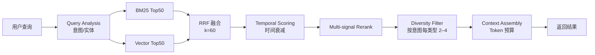

# 检索流程

## 检索评估的输入与结果边界

`benchmarks.runners.retrieval_runner` 的黄金集加载拒绝非法相关性分级（必须为整数 0–3）、同 query_id 不同问题、同一 query/memory 的矛盾标注。运行前检查所有 ≥2 分正例都存在于目标工作区的 active 语料；缺失时报错，不把数据集与语料错配伪装成普通召回下降。0/1 分项可引用目标语料外的负例，例如其他工作区的隔离探针，因此不强制其存在。空评估集与未知 pipeline 也会报错。

现有 `eval-fixture` 与 `eval-fixture-extended` 是合成/定向夹具，不是独立人工标注的真实任务集。带工作区名称的黄金文件本身也不证明标注来源；使用前需核对来源及当前记忆 ID。评估应显式指定隔离夹具数据库、工作区和数据集，避免默认连接个人库；只需只读查询时使用 SQLite `mode=ro&uri=true` 连接，并在结束后释放独立 engine。

运行器名为 `full_pipeline` 的分支实际比较候选检索、重排和多样性选择，不经过生产 API、图扩展、最终上下文组装或回答生成；不能把它的 Recall/MRR 当作端到端任务成功率。负例 `negative_fp_rate_at_10` 仅测 top-10 是否包含已标注 ≥1 分干扰项，不代表无关查询有任何返回的比例，也无法识别未标注结果的错误。合成集上的结果应与真实任务人工验收分开报告。

### 逐查询证据与负例诊断

JSON 报告的 `per_query` 保留 `query`、`ranked_memory_ids` 与逐项对应的 `ranked_relevance`。排名从数组下标 + 1 读取；未标注项为 `null`，必须与明确标注不相关的 `0` 区分。这样可以回查干扰项究竟被移除、降到 top-10 外，还是仅因标注稀疏而看似通过。报告可能包含查询文本与记忆 ID，分享前应检查敏感信息。

固定合成夹具的 C9 诊断显示：C9-q1 的缓存互斥干扰项在 BM25 排第 4，RRF 排第 10、重排后第 7，类型多样性过滤后未返回；C9-q2 的 Redis 主从部署干扰项在向量排第 1、RRF 第 5、重排后第 13，经类型多样性过滤补位到第 10。多样性只限制同类型数量，不执行领域匹配或无答案拒答，因此相同的汇总误召回率会隐藏不同失败路径。两条查询的 full_pipeline 仍分别返回 17/18 条记忆，其中 17/17 条未标注，不能据此认定无关查询被正确拒答。这些是该夹具上的观察，不构成生产阈值调参依据。

### 从候选到组装交付

上下文基准 JSON 的 `delivery_diagnostics` 保存最终 ID、正文、Token 计数/渲染估算、截断标志和 `filter_events`。事件不等于淘汰：`expired_demoted` 等降权事件允许记忆继续交付，须以最终 ID 为准。诊断正文可能包含敏感信息，不应直接分享个人语料报告。

在同一 C9 合成夹具上，将 benchmark full_pipeline 的候选及真实重排分数送入共享 `assemble_context`（不套用手工 gold 的 hard/0.5 门限）：C9-q1 的已标注干扰项在上游已被多样性过滤，组装器未接收；C9-q2 的过时 Redis 主从条目被 `expired_demoted` 降权，在 1000/2000 Token 预算下因预算未交付，但在 4000 预算下仍交付。较小预算的偶然淘汰不代表领域过滤成功，预算增大也不保证质量提升。

此诊断仅连接了 benchmark 候选检索/重排与共享组装器，未运行生产引擎的全部过滤/扩展、API 新鲜度重排或最终回答生成；不能据此断言线上 API 必然泄漏该条目。后续真实验收应同时记录生产入口候选、最终正文及独立人工标注，验证跨领域结果是否被实际消费。

### 隔离生产 API 入口验收

`tests/api/test_context_fixture_acceptance.py` 将可选合成 SQLite 夹具以只读方式加载，再将其记忆复制到测试数据库；通过 ASGI HTTP 调用真实 `/v1/context`，执行真实 `RetrievalEngine`、路由新鲜度重排/去重、共享组装与 usage 写入。查询用独立 session，核对最终正文、items、sources、citations、total 与 `used` 流水的一致性及渲染 Token 预算。源夹具不存在时跳过，不创建空库。运行：`python -m pytest tests/api/test_context_fixture_acceptance.py -q -s`，输出包含引擎出参 ID 与完整 API 响应，可重定向保存证据。

固定 C9 夹具在 1000/2000/4000 Token 下：q1 引擎返回 17 条，API 分别交付 7/14/17 条，已标注干扰项不在引擎出参；q2 引擎返回 18 条，API 分别交付 7/14/18 条，Redis 主从干扰项在前两个预算下未交付、4000 下进入正文与引用，且对应 `used` 流水与交付一致。这确认该路径上存在质量问题，不是响应与计账错位；测试通过仅表示合同一致性通过，并不表示领域相关性通过。

边界：此测试使用 DB 中的合成 embedding，未接入运行中服务 lifespan 初始化的文件向量索引，也未复制个人库、关系图、Agent 偏好历史或来源证据表。输出的 `degraded: []` 只表示未触发代码定义的降级标记，不证明等同实际设备全链路。没有生成最终回答或人工完整标注未标注结果；不能将该合成案例的误交付推算为线上频率，也不能据此直接收紧生产阈值。下一步应补充跨领域负例及应召回正例的配对标注，再比较候选级领域相关性门控与现状，避免误伤有效跨领域知识。

### 离线领域门控配对消融

`benchmarks/datasets/retrieval/domain-pairs.json` 是 Agent 根据夹具正文编写的 12 个诊断配对（7 正例、5 负例），不是独立人工标注，也不是现有 0–3 相关性等级的替代。标注目标是“该条目是否支持该问题”，包括同一记忆对不同问题有用/无用、显式跨领域对比、隐式哨兵借鉴、同领域不同主题与历史回顾。源正文来自 `generate_fixture.py`，无需访问任何数据库。

运行 `python -m benchmarks.runners.domain_gate_runner`：比较全部保留基线、只匹配查询首个产品名、匹配查询任意显式产品名三种策略；仅识别 Redis/MySQL/SQLite，未知领域放行。该实验是在预先给定的 query-document 对上比较保留/排除，不是检索召回率或 API 改善实验，基线负例拒绝率 0% 是定义结果。

本组数据结果：基线保留 7/7 正例、拒绝 0/5 负例；首领域策略保留 5/7、拒绝 3/5；任意显式领域策略保留 6/7、拒绝 3/5。允许多个显式领域解决了对比任务的一次误伤，但仍将“借鉴哨兵选主”的跨领域正例排除；两种门控都放过了 Redis 分布式锁安全释放问题中的缓存击穿材料，以及 slot 路由问题中的缓存材料。仅靠产品名重叠既会误伤，又不能识别同领域主题不匹配。

因此目前不将该词表门控接入生产，也不凭这 12 对调阈值。下一阶段需要独立标注和保留集，覆盖产品别名、历史材料、有效跨领域迁移及同域难负例；候选级主题/任务支持性门控还须在完整检索和最终 API 正文上复验。应分别报告正例损失和负例拒绝，不能只报“过滤掉多少”。

### 盲审材料与外部标签回填

`python -m benchmarks.runners.relevance_review export benchmarks/datasets/retrieval/domain-pairs.json > review-packet.json` 导出查询、完整标题/正文和内容摘要 ID，不携带现有标签、理由、描述性 ID、源 key 或策略结果。按内容摘要排序而非原正负例顺序；每项及整包均绑定快照摘要。摘要用于错配检测，不是签名或独立性证明；标题/正文保留原义，包括材料已废弃等真实信息。

评审人只查看导出的 packet，不查看源标签或比较报告。回填 JSON 根字段为 `packet_id`、非空 `reviewer`、`judgments`；每条 judgment 只包含 `pair_id`、布尔 `relevant`、非空 `rationale`。判断“材料是否支持问题”，而非只看同产品名；不确定项应暂停确认，不能用 null 混入评分。不要把个人原文 packet 公开分享。

`python -m benchmarks.runners.relevance_review check review-packet.json annotations.json` 严格拒绝错包、正文快照变化、重复/未知/缺失 judgment、整数伪布尔、空理由与额外字段。命令行 JSON 读取还拒绝任意层级重复字段（包括重复 `relevant`），避免默认 JSON 解析器静默使用最后一个值；支持 UTF-8 BOM，要求根节点为对象。成功只代表标签合同有效，输出始终保留 `independence_verified: false`，工具无法证明 reviewer 身份或确实盲审。

已公开用于策略分析的这 12 对只能作为 `development`，不会因去掉标签或人工重审就变成 held-out；工具拒绝其改称 heldout。未建立独立保留集。显式执行 `python -m benchmarks.runners.relevance_review compare review-packet.json annotations.json` 可在完整校验后比较三种门控：只使用 packet 的正文快照和回填标签，不回读夹具或原合成标签；按 pair_id 连接而非依赖回填顺序。输出保留 reviewer、packet_id、development 及 `independence_verified: false`，缺少某类标签时相应比率为 null 而不是虚构 100%。比较结果不是检索/API 成功率，也不证明人工身份；报告可能含原文和理由，分享前需脱敏。真正保留集需另收未用于策略设计的查询，按查询组隔离（包括改写及同一任务的多个候选），先冻结策略再独立标注；不能将这份开发集的样本随机切分后宣称独立验证。

## 流程概览



## Rerank 信号权重

重排分两组，组内各自归一，config.yaml 可配置：

**相关性组**

| 信号 | 默认权重 | 说明 |
|------|---------|------|
| `rrf` | 0.40 | RRF 分数 / 理论满分（`(bm25_weight+vector_weight)/(RRF_K+1)`） |
| `semantic` | 0.30 | 向量余弦相似度（绝对值） |
| `bm25` | 0.30 | BM25 分数 / 池内最大值 |
| `intent` | 0.15 | 意图-类型匹配，以中性 0.5 为中心 |

`key_term_bonus`（默认 0.08）为相关性组内的加性奖励；否定词命中对相关性做乘性衰减（保底 20%）。

**元数据组（仅 `band` 内生效）**

| 信号 | 默认权重 | 说明 |
|------|---------|------|
| `confidence` | 0.35 | 记忆置信度 |
| `importance` | 0.30 | 重要度 |
| `freshness` | 0.20 | 新鲜度 |
| `usage` | 0.15 | 使用频率 |

最终分：

```
final = (1 - band) × relevance + band × metadata
```

`reranker_relevance_band` 默认 0.05：元数据最多翻转相关性差 ≤band 的候选，不能跨带压过相关性。`band=0` 即纯相关性排序。RRF 用理论满分锚定而非池内 min-max，候选池大小变化不会改变同名词次的相关性分。

权重由 `benchmarks/runners/calibrate_reranker.py` 在固定种子的 eval-fixture 上标定（20% 查询留出做过拟合检查），真实库另做不回退抽样。

---

## 各阶段详解

### 1. Query Analysis

分析用户查询，提取意图（intent）和实体。意图类型包括：`project_rule`、`lesson`、`fact`、`procedure`、`constraint`、`decision`。

### 2. 双路召回

- **BM25**：关键词文本检索，支持增量更新（add/remove/update），返回 Top 50
- **Vector**：向量余弦相似度检索（numpy 矩阵运算 + argpartition top-k），返回 Top 50

### 3. RRF 融合

Reciprocal Rank Fusion，k=60，`bm25_weight=0.6` / `vector_weight=0.4`（config.yaml）。将两路结果按排名加权融合为统一候选池。

```
RRF_score(d) = bm25_weight / (k + rank_bm25(d)) + vector_weight / (k + rank_vec(d))
```

### 4. Temporal Scoring

基于记忆的有效期（valid_from / valid_to）、创建时间、最后使用时间计算时间衰减分数。

### 5. Multi-signal Rerank

相关性组与元数据组按上文公式合成。意图匹配度（intent bonus）根据查询意图与记忆类型的匹配关系计算：

| 查询意图 | 高匹配类型 | 次匹配类型 |
|----------|-----------|-----------|
| `project_rule` | rule (1.0) | constraint (0.8) |
| `lesson` | lesson (1.0) | issue (0.8) / decision (0.6) |
| `procedure` | procedure (1.0) | rule (0.5) |
| `decision` | decision (1.0) | lesson (0.5) |
| `constraint` | constraint (1.0) | rule (0.8) |
| `fact` | fact (1.0) | — |
| `unknown` | 所有类型 (0.5) | — |

意图匹配以中性 0.5 为中心：unknown 或类型不匹配不改变相关性，匹配类型才产生正加成。

### 6. Diversity Filter

按查询意图限制每种记忆类型最多返回 2–4 条（fact 4、procedure 3、lesson 3、project_rule 2、constraint 2、decision 3、unknown 3），确保结果多样性；显式指定 `memory_type` 过滤时不限同类型条数（上限为 `top_k`）。

### 7. Context Assembly

在 Token 预算内组装记忆内容，生成可直接注入 Prompt 的上下文文本。每条记忆带可追溯属性：

```xml
[1] [FACT] 标题
<memory type="fact" id="..." source="mcp" version="3" confidence="0.50" evidence="2" updated="2026-11-01">
正文
</memory>
```

`source / version / confidence / evidence` 来自正式记忆与 Evidence 表；`updated` 只取日期以控制 token。结构化引用另由 `/v1/context` 的 `citations` 返回。

组装排序同样采用相关性主导：

```
rank_score = score + band × ((1-utility_weight) × 类型优先级 + utility_weight × utility)
```

类型优先级与效用只在 band 内翻转候选，不会整体重排检索结果。embedding 微调（band 默认 0.03）也在 `rank_by_priority` 之前执行，仅用于近邻并列的语义补足。

---

## BM25 索引构建与缓存

BM25 索引按 `(workspace_id, project_id)` 作用域构建，只收录 `status = "active"` 的记忆。`workspace_id=None` 时构建全库索引（跨全部工作区），`/v1/search` 省略 `workspace_id` 即走该作用域；向量检索同样支持省略（不施加工作区过滤）。

### 内容指纹

引擎不在每次检索时全量重建，而是先在数据库侧计算内容指纹：

```
fingerprint = (active 数量, MAX(updated_at), SUM(LENGTH(title) + LENGTH(content)))
```

指纹与上次构建一致且未超过 60 秒 TTL（`_INDEX_MAX_AGE_SECONDS`）时，直接复用缓存索引。

### 失效保证

- **写操作**：SQLAlchemy 的 `onupdate=func.now()` 使 `Memory.updated_at` 自动更新，指纹变化
- **结构变化**：插入、状态离开 active 和删除都会改变 active 数量，指纹变化
- **已知盲区**：SQLite `CURRENT_TIMESTAMP` 秒级精度，同秒同总长度原地编辑可能漏检，由 60 秒 TTL 兜底

### 缓存策略

- 按作用域最多保留 4 条（`_INDEX_CACHE_SIZE`），FIFO 淘汰（Python 3.7+ dict 保持插入顺序，`pop(next(iter(...)))` 即 O(1) FIFO）
- 并发检索各自持有返回的索引实例，缓存条目只在完整构建后原子替换

### 增量更新

BM25 索引支持增量 `add()` / `remove()` / `update()`，无需调用 `build()` 全量重建。

- `add()` 维护文档频率（DF）、总文档长度（avgdl）和倒排索引（`_postings`）的增量统计
- 已存在的 `doc_id` 先移除旧版本再添加
- 内部通过 `_id_to_idx` 映射实现 O(1) 文档位置查找
- 添加后索引立即可搜索（`_built = True`）

### 倒排索引加速

`search()` 使用倒排索引（`_postings: token → list[doc_idx]`）只遍历包含查询词的文档，而非全量扫描。查询时先取各词项 posting 的并集作为候选文档集，再仅对这些文档计算 BM25 分数。文档库越大，加速效果越显著。

---

## 关系图扩展与 Hebbian 强化

重排后取前 5 条记忆，沿显式关系边做一跳扩展。关系按无向图处理：入边与出边都会把另一端作为邻居，邻居加分：

```
boost = (0.15 × confidence + 0.10 × effective_strength) × band / 0.25
effective_strength = strength × 0.5 ^ (距上次强化的天数 / 半衰期天数)
```

- 邻居加分按理论满分 0.25 等比缩放到 `reranker_relevance_band`（默认 0.05）：保留邻居之间的强度差异，但最大加分不超过 band，关系图不会压过检索相关性。

- 邻居仍受 `memory_type`、`min_confidence`、`min_similarity` 与 `tags` 过滤约束，不会绕过检索条件。
- 每次 `record_trace=True` 的检索结束后，对最终结果中两端都命中的**既有关系边**做 Hebbian 强化：先按半衰期衰减，再按 `strength += rate × (1 - strength)` 逼近 1。不会自动新建关系边，避免关系图噪声膨胀。
- 同一批记忆的 `usage_count` 加 1，并更新 `last_used_at`，使使用信号进入重排与效用分。
- 开关与参数在 `config.yaml` 的 `parasitic_evolution`：`relation_reinforcement_enabled`、`relation_reinforcement_rate`（默认 0.2）、`relation_decay_half_life_days`（默认 30）。代码默认关闭，仓库配置默认开启。

---

## 批量 Embedding 生成

`EmbeddingService` 使用 fastembed 本地 ONNX 模型生成向量，零外部 API 依赖：

1. 优先使用 fastembed 本地 ONNX 模型（`TextEmbedding`）
2. 模型不可用时 fallback 到 hash-based embeddings（确定性、可复现）；失败不永久降级——按 60 秒冷却间隔自动重试加载，成功后恢复本地模型
3. `GET /v1/metrics` 的 `embedding` 段暴露当前 provider（`local` / `hash` / `not_initialized`）、`load_failures` 与 `last_load_error`
4. `generate_embeddings_batch(texts, batch_size=256)` 批量生成，内部按 `batch_size` 分块
5. 返回与输入等长的列表，失败项为 `None`

> 单条 `generate_embedding(text)` 已委托给批量方法，自身为薄包装。Worker 的 `batch_generate_embeddings` 任务一次性收集所有缺少 embedding 的 active memories 和 pending_review candidates，批量处理后分别持久化。

---

## 向量索引性能

`VectorIndex` 搜索使用 numpy 矩阵运算替代逐条 Python 循环：

- **矩阵运算**：构建 `(n, d)` 矩阵后单次 `matrix @ query_vec` 计算所有点积
- **Top-k 选择**：`np.argpartition` 实现 O(n) 复杂度
- **原子写入**：write-to-temp-then-rename，防止进程崩溃导致数据损坏
- **一致性校验**：加载时 `len(ids) != len(vecs)` 则清空重建

> 索引文件 `index.db`（Markdown 文件索引，SQLite 表 `memory_index`）与 `vectors.npz`（向量）位于 `cwiki-data/` 下随 Git 同步，两者均为派生数据，可随时删除后从 Markdown 记忆重建（`python tasks.py rebuild-db`）。BM25 倒排索引是进程内存结构，不落盘。
