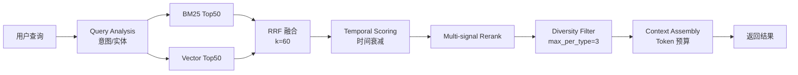

# 检索流程

## 流程概览



## Rerank 信号权重

config.yaml 可配置，总和为 1.0：

| 信号 | 权重 | 说明 |
|------|------|------|
| `rrf` | 0.38 | RRF 融合分数 |
| `importance` | 0.16 | 重要度 |
| `confidence` | 0.13 | 记忆置信度 |
| `freshness` | 0.13 | 新鲜度 |
| `intent` | 0.12 | 意图-类型匹配度 |
| `usage` | 0.08 | 使用频率 |
| `key_term` | 0.08 | 关键术语命中加成 |

---

## 各阶段详解

### 1. Query Analysis

分析用户查询，提取意图（intent）和实体。意图类型包括：`project_rule`、`lesson`、`fact`、`procedure`、`constraint`、`decision`。

### 2. 双路召回

- **BM25**：关键词文本检索，支持增量更新（add/remove/update），返回 Top 50
- **Vector**：向量余弦相似度检索（numpy 矩阵运算 + argpartition top-k），返回 Top 50

### 3. RRF 融合

Reciprocal Rank Fusion，k=60。将两路结果按排名融合为统一候选池。

```
RRF_score(d) = Σ 1 / (k + rank_i(d))
```

### 4. Temporal Scoring

基于记忆的有效期（valid_from / valid_to）、创建时间、最后使用时间计算时间衰减分数。

### 5. Multi-signal Rerank

加权综合多信号：RRF 分数、置信度、重要度、意图匹配度、新鲜度、使用频率。

意图匹配度（intent bonus）根据查询意图与记忆类型的匹配关系计算：

| 查询意图 | 高匹配类型 | 次匹配类型 |
|----------|-----------|-----------|
| `project_rule` | rule (1.0) | constraint (0.8) |
| `lesson` | lesson (1.0) | decision (0.6) |
| `procedure` | procedure (1.0) | rule (0.5) |
| `decision` | decision (1.0) | lesson (0.5) |
| `constraint` | constraint (1.0) | rule (0.8) |
| `fact` | fact (1.0) | — |
| `unknown` | 所有类型 (0.5) | — |

### 6. Diversity Filter

限制每种记忆类型最多返回 3 条（`max_per_type=3`），确保结果多样性。

### 7. Context Assembly

在 Token 预算内组装记忆内容，生成可直接注入 Prompt 的上下文文本。

---

## BM25 索引构建与缓存

BM25 索引按 `(workspace_id, project_id)` 作用域构建，只收录 `status = "active"` 的记忆。`workspace_id=None` 时构建全库索引（跨全部工作区），`/v1/search` 省略 `workspace_id` 即走该作用域；向量检索同样支持省略（不施加工作区过滤）。

### 内容指纹

引擎不在每次检索时全量重建，而是先在数据库侧计算内容指纹：

```
fingerprint = (active 数量, MAX(updated_at), SUM(LENGTH(title) + LENGTH(content)))
```

指纹与上次构建一致且未超过 60 秒 TTL（`_INDEX_MAX_AGE_SECONDS`）时，直接复用缓存索引。

### 失效保证

- **写操作**：SQLAlchemy 的 `onupdate=func.now()` 使 `Memory.updated_at` 自动更新，指纹变化
- **结构变化**：插入、归档和删除改变 active 数量，指纹变化
- **已知盲区**：SQLite `CURRENT_TIMESTAMP` 秒级精度，同秒同总长度原地编辑可能漏检，由 30 秒 TTL 兜底

### 缓存策略

- 按作用域最多保留 4 条（`_INDEX_CACHE_SIZE`），FIFO 淘汰（Python 3.7+ dict 保持插入顺序，`pop(next(iter(...)))` 即 O(1) FIFO）
- 并发检索各自持有返回的索引实例，缓存条目只在完整构建后原子替换

### 增量更新

BM25 索引支持增量 `add()` / `remove()` / `update()`，无需调用 `build()` 全量重建。

- `add()` 维护文档频率（DF）、总文档长度（avgdl）和倒排索引（`_postings`）的增量统计
- 已存在的 `doc_id` 先移除旧版本再添加
- 内部通过 `_id_to_idx` 映射实现 O(1) 文档位置查找
- 添加后索引立即可搜索（`_built = True`）

### 倒排索引加速

`search()` 使用倒排索引（`_postings: token → list[doc_idx]`）只遍历包含查询词的文档，而非全量扫描。查询时先取各词项 posting 的并集作为候选文档集，再仅对这些文档计算 BM25 分数。文档库越大，加速效果越显著。

---

## 关系图扩展与 Hebbian 强化

重排后取前 5 条记忆，沿显式关系边做一跳扩展。关系按无向图处理：入边与出边都会把另一端作为邻居，邻居加分：

```
boost = 0.15 × confidence + 0.10 × effective_strength
effective_strength = strength × 0.5 ^ (距上次强化的天数 / 半衰期天数)
```

- 邻居仍受 `memory_type`、`min_confidence`、`min_similarity` 与 `tags` 过滤约束，不会绕过检索条件。
- 每次 `record_trace=True` 的检索结束后，对最终结果中两端都命中的**既有关系边**做 Hebbian 强化：先按半衰期衰减，再按 `strength += rate × (1 - strength)` 逼近 1。不会自动新建关系边，避免关系图噪声膨胀。
- 同一批记忆的 `usage_count` 加 1，并更新 `last_used_at`，使使用信号进入重排与效用分。
- 开关与参数在 `config.yaml` 的 `parasitic_evolution`：`relation_reinforcement_enabled`、`relation_reinforcement_rate`（默认 0.2）、`relation_decay_half_life_days`（默认 30）。代码默认关闭，仓库配置默认开启。

---

## 批量 Embedding 生成

`EmbeddingService` 使用 fastembed 本地 ONNX 模型生成向量，零外部 API 依赖：

1. 优先使用 fastembed 本地 ONNX 模型（`TextEmbedding`）
2. 模型不可用时 fallback 到 hash-based embeddings（确定性、可复现）；失败不永久降级——按 60 秒冷却间隔自动重试加载，成功后恢复本地模型
3. `GET /v1/metrics` 的 `embedding` 段暴露当前 provider（`local` / `hash` / `not_initialized`）、`load_failures` 与 `last_load_error`
4. `generate_embeddings_batch(texts, batch_size=256)` 批量生成，内部按 `batch_size` 分块
5. 返回与输入等长的列表，失败项为 `None`

> 单条 `generate_embedding(text)` 已委托给批量方法，自身为薄包装。Worker 的 `batch_generate_embeddings` 任务一次性收集所有缺少 embedding 的 active memories 和 pending_review candidates，批量处理后分别持久化。

---

## 向量索引性能

`VectorIndex` 搜索使用 numpy 矩阵运算替代逐条 Python 循环：

- **矩阵运算**：构建 `(n, d)` 矩阵后单次 `matrix @ query_vec` 计算所有点积
- **Top-k 选择**：`np.argpartition` 实现 O(n) 复杂度
- **原子写入**：write-to-temp-then-rename，防止进程崩溃导致数据损坏
- **一致性校验**：加载时 `len(ids) != len(vecs)` 则清空重建

> 索引文件 `index.db`（BM25）与 `vectors.npz`（向量）位于 `cwiki-data/` 下随 Git 同步，两者均为派生数据，可随时删除后从 Markdown 记忆重建（`python tasks.py rebuild-db`）。
